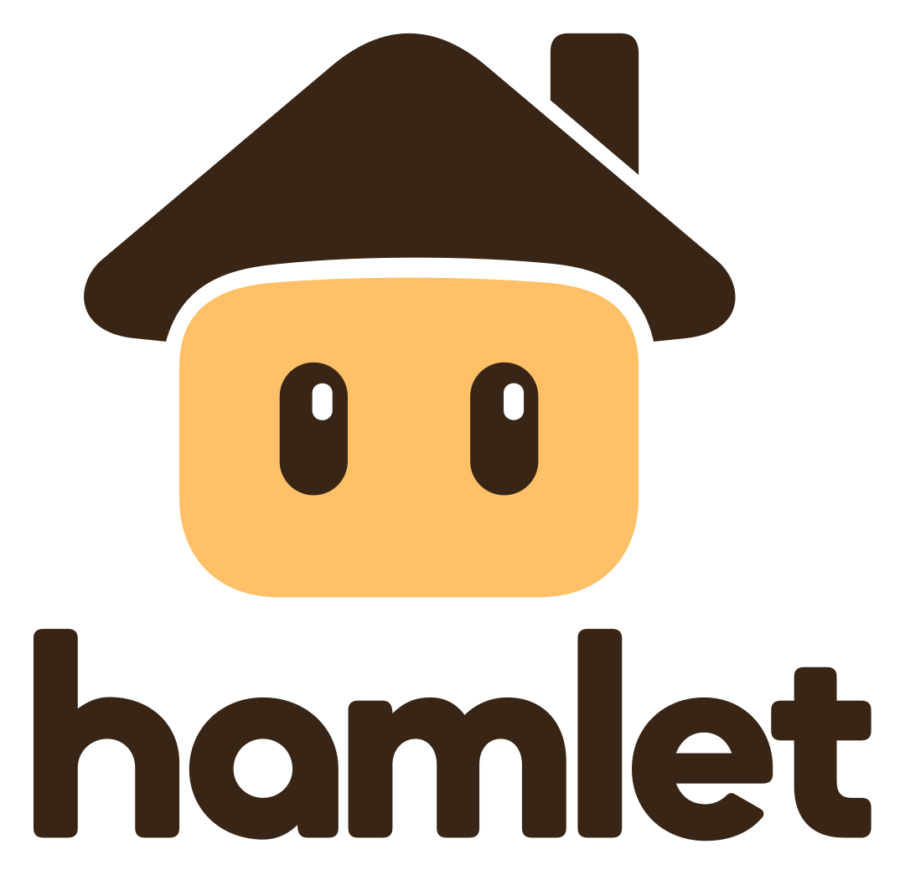
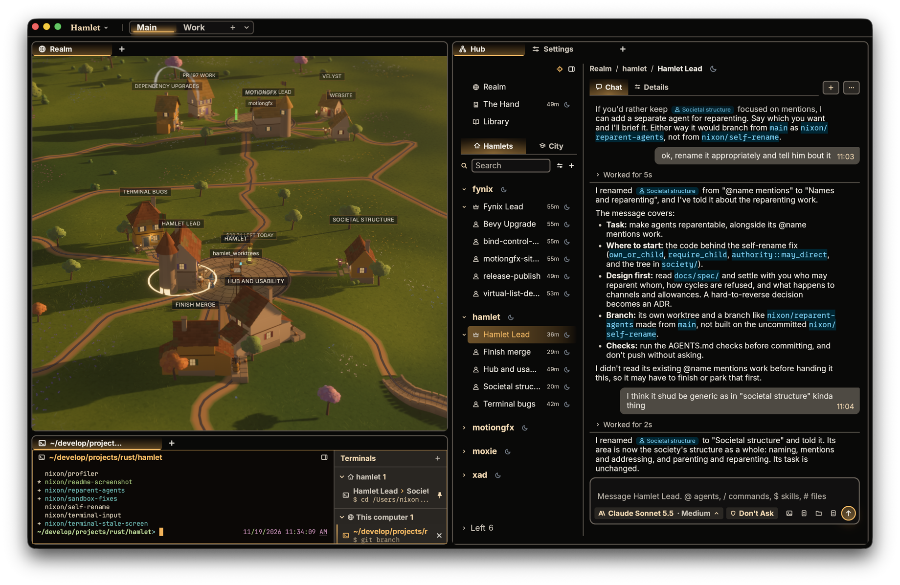

<p align="center">
  <picture>
    <source media="(prefers-color-scheme: dark)" srcset="brand/logo/hamlet-logo-transparent.png">
    
  </picture>
</p>

# Hamlet

[](https://github.com/voxell-tech/hamlet#license)
[](https://github.com/voxell-tech/hamlet/actions)
[](https://discord.gg/hJjjTkXRKw)
[](https://discord.gg/Mhnyp6VYEQ)

**Hamlet** is an agent orchestrator. You lead hamlets of AI agents and
watch them work in a small 3D world where each agent is a robot. Free
and open-source forever.

<p align="center">
  
</p>

## Features

- **The Hand**: You are the chief and talk to the Hand, your own agent
  above every hamlet. It founds hamlets and starts workers for small
  jobs.
- **Profiles that learn**: An agent is of a profile, a git repository of
  a character, memory and skills. It works on a branch of its own, and
  what it learns is merged into the profile's `main`.
- **Hamlets that run themselves**: A hamlet's lead adds and directs
  agents.
- **Agents that grow**: Agents write their own skills, shared through a
  library.
- **Your code**: Give a hamlet a folder and its agents work in it.
- **You stay in charge**: In manual mode every edit and command waits for
  your approval. In auto mode the sandbox keeps writes in the folder.
- **Any model**: Any OpenAI-compatible endpoint, a local
  [Ollama](https://ollama.com) by default.

The words are in [`CONTEXT.md`](CONTEXT.md).

Early and moving fast. The server owns the realm, the pi harness owns
conversations and model calls, and the window is a protocol client:
closing it stops no agent.

## Install

Download the file for your system from the
[latest release](https://github.com/voxell-tech/hamlet/releases/latest).
Each includes everything Hamlet needs, Node too. A build of the newest
changes is on the
[nightly release](https://github.com/voxell-tech/hamlet/releases/tag/nightly),
and **Settings > Updates** moves a copy between the Stable, Beta and
Nightly [channels](docs/releases.md#updates).

| System | File | Then |
| --- | --- | --- |
| macOS (Apple Silicon) | `Hamlet-<version>.dmg` | Open it and drag Hamlet onto Applications. |
| Ubuntu, Debian, Mint | `hamlet_<version>_amd64.deb` | Open it with Software Install (App Center). |
| Fedora | `hamlet-<version>-1.x86_64.rpm` | Open it with Software. |
| Windows (x64) | `Hamlet-<version>-Setup.exe` | The app cannot start its server, since Windows has no sandbox; see [Tools and platforms](#tools-and-platforms). |

Open Hamlet from your applications. On macOS and Linux it starts its
server and opens the window, which walks you through choosing a model.
On Windows, start the server with `hamlet --insecure` in a terminal
first. Until a release is
signed, macOS refuses the app the first time: choose **Open Anyway** in
**System Settings > Privacy & Security**. On Windows choose **More
info**, then **Run anyway**. Archives for a terminal are in
[releases](docs/releases.md).

## Quick start

You need Rust, git and Node **24.1.0** (pinned in `harnesses/pi/.nvmrc`).
From the repository root:

```sh
cargo xtask install
hamlet
```

This puts `hamlet`, `hamlet_server` and `hamlet_app` in `~/.cargo/bin`
and starts your realm in `~/.hamlet`. It uses the checkout's
`harnesses/pi/`: keep the checkout, and install again after pulling.

## Try it without installing

Use a scratch folder so your real `~/.hamlet` is untouched:

```sh
HAMLET_HOME=/tmp/hamlet-try cargo xtask dev
```

`dev` builds the local server and window and opens the window. Closing
the window leaves `hamlet dev` serving; Ctrl-C stops it. Other commands
run as `cargo run -p hamlet_cli -- <command>`; `hamlet --help` lists
them. Run `hamlet server` and `hamlet window` apart with both
`HAMLET_HOME` and `HAMLET_VIEW` set to scratch folders.

## Configuration

### Models and credentials

Use an API key, a local model endpoint, or sign in with ChatGPT, Claude
or OpenRouter. Credentials stay on the server.

### Tools and platforms

- Local tools need Seatbelt on macOS or working bubblewrap on Linux.
- A remote workspace chosen in Settings takes effect on restart and
  never falls back to local execution.
- Windows has no sandbox. A Windows server starts only with
  `hamlet --insecure`, and agents' commands then reach whatever your
  account can. Linux and macOS refuse `--insecure`.

### Environment variables

| Variable | Meaning |
| --- | --- |
| `HAMLET_HOME` | The server's realm folder. Defaults to `~/.hamlet`. |
| `HAMLET_VIEW` | The window's size, layout and theme. Defaults to the OS's config folder. |
| `HAMLET_SERVER_BIN` | An existing server binary; `dev` skips its build. |
| `HAMLET_APP` | An existing window binary; `dev` skips its build. |
| `HAMLET_SERVER` | A remote WebSocket URL, never an executable. |
| `HAMLET_TOKEN` | The remote realm's token, which `HAMLET_SERVER` needs. |
| `HAMLET_PI_HARNESS` | Pi's `src/main.ts`. |
| `HAMLET_NODE` | A Node executable. |
| `HAMLET_NO_UPDATE` | Set, an installed release stops looking for [updates](docs/releases.md#updates). |

## Working on the code

Clone with `--recurse-submodules` (`vendor/fynix`). `cargo xtask check`
runs the same checks as CI and `cargo xtask help` lists every task.
[`docs/tour.md`](docs/tour.md) is the map of the code,
[`docs/`](docs/README.md) lists every page and [`AGENTS.md`](AGENTS.md)
has the rules for working here.

## Join the community!

Join the [Hamlet](https://discord.gg/hJjjTkXRKw) or
[Voxell](https://discord.gg/Mhnyp6VYEQ) discord server.

## License

`hamlet` is dual-licensed under either:

- MIT License ([LICENSE-MIT](LICENSE-MIT) or
  [http://opensource.org/licenses/MIT](http://opensource.org/licenses/MIT))
- Apache License, Version 2.0 ([LICENSE-APACHE](LICENSE-APACHE) or
  [http://www.apache.org/licenses/LICENSE-2.0](http://www.apache.org/licenses/LICENSE-2.0))

You can select the license you prefer. Dual licensing is the standard in
the Rust ecosystem, for [good reasons](https://github.com/bevyengine/bevy/issues/2373).
