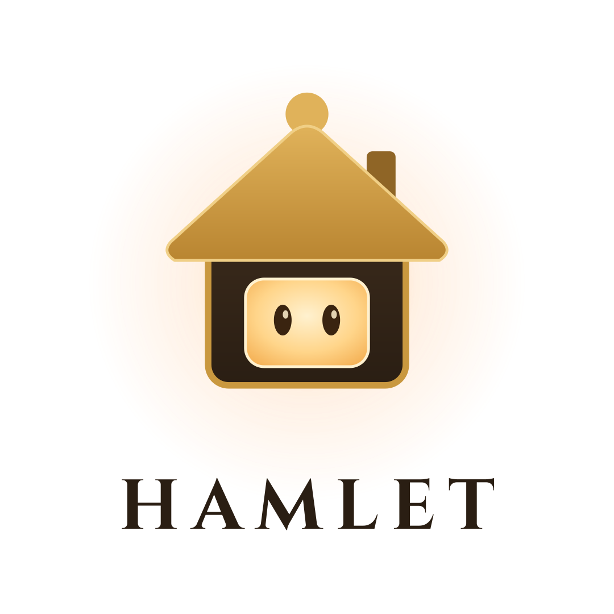
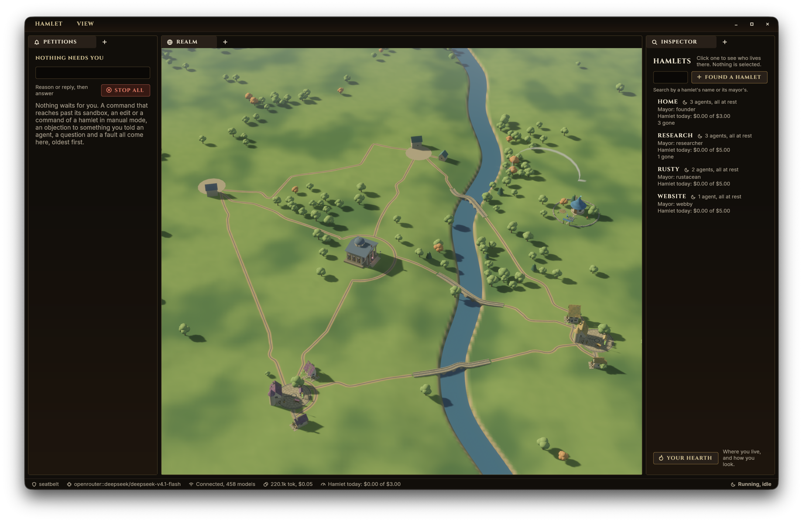

<p align="center">
  <picture>
    <source media="(prefers-color-scheme: dark)" srcset="brand/hamlet-logo-wordmark-transparent.png">
    
  </picture>
</p>

# Hamlet

[](https://github.com/voxell-tech/hamlet#license)
[](https://github.com/voxell-tech/hamlet/actions)
[](https://discord.gg/hJjjTkXRKw)
[](https://discord.gg/Mhnyp6VYEQ)

**Hamlet** is an agent orchestrator. You lead a hamlet of AI agents and
watch them work in a small 3D world where each agent has a house and a
robot. Free and open-source forever.

<p align="center">
  
</p>

## Features

- **One lead, many agents**: You are the chief and talk to the mayor, the
  agent that creates the others the work needs and lays the roads. Each
  agent has its own notes, skills and log.
- **Agents that grow**: An agent starts with a sandboxed shell, a file
  editor and a notes file, and writes its own skills from there.
- **Agents talk to each other**: Messages travel along roads the mayor
  lays between houses.
- **Point a hamlet at your code**: Give a hamlet a folder and its agents
  work in it, as a coding agent does.
- **You stay in charge**: In manual mode every edit and command waits for
  your approval. In auto mode the sandbox keeps writes inside the folder.
  Agents can vote a mayor out, and the chief can overrule anything.
- **Many hamlets at once**: Hamlets sit side by side, each with its own
  agents, budget and folder.
- **Any model**: Any OpenAI-compatible endpoint, a local
  [Ollama](https://ollama.com) by default.

## New here?

Hamlet's words in one minute:

| Word | Meaning |
| --- | --- |
| **Chief** | You, the human who leads. |
| **Hamlet** | A group of agents with a budget and, optionally, a folder to work in. |
| **Mayor** | The lead agent. You talk to it, and it creates the other agents and lays the roads. |
| **Agent** | An AI worker with a house, a robot, and its own notes, skills and log. |
| **Road** | A path between houses that agents' messages travel along. |

The shortest path to seeing it work:

1. Follow the [Quick start](#quick-start) below.
2. Give Hamlet a model: an API key, a local model endpoint, or a sign-in
   (see [Models and credentials](#models-and-credentials)).
3. Click a robot or house in the window and say what you want done.
4. Watch the agents work. Approve edits and commands as they ask.

Not ready to install anything? [Try it without
installing](#try-it-without-installing) uses a scratch home that leaves
your real files alone.

## Status

Early and moving fast.

- **`hamlet_server`** (Rust) owns the agents, roads, letters, votes,
  library, approvals and budgets.
- **pi harness** (Node processes) owns conversations and model calls.
- **The window** is a protocol client. Closing it stops no agent.
- **Tests** use faux and loopback providers. They do not establish
  exhaustive behavior or platform coverage.

## Quick start

You need Rust, git and Node **24.1.0** (pinned in `harnesses/pi/.nvmrc`).
From the repository root:

```sh
cargo xtask install
hamlet
```

This installs pi's packages, puts `hamlet`, `hamlet_server` and
`hamlet_app` in `~/.cargo/bin`, and starts on your home, `~/.hamlet`.

> [!NOTE]
> A source install uses the checkout's `harnesses/pi/`. Keep the checkout,
> and run `cargo xtask install` again after pulling.

### Release archives

| Platform | What you get | Needs |
| --- | --- | --- |
| Linux, macOS | All three binaries and a `pi/` package with production dependencies | Installed Node. No checkout or npm install. |
| Windows | A window-only archive for connecting to a remote server | Nothing. No Node or pi. |

See [releases](docs/releases.md).

### Other `cargo xtask` commands

| Command | What it does |
| --- | --- |
| `cargo xtask build` | Builds without installing |
| `cargo xtask all` | Builds every binary, including `hamlet_workspace` |
| `cargo xtask uninstall` | Removes all three binaries |
| `cargo xtask dev` | Tries the checkout without installing (see below) |
| `cargo xtask help` | Lists every task |

## Try it without installing

Use a scratch home so your real `~/.hamlet` is untouched:

```sh
HAMLET_HOME=/tmp/hamlet-try cargo xtask dev
```

`dev` builds the local server and window, starts the server on a free
port, and opens the window. No global npm command is needed.

- The home is kept between runs. The window's files go in `<home>/window`.
- Closing the window leaves `hamlet dev` serving. Ctrl-C stops it.
- To run other commands without installing, use
  `cargo run -p hamlet_cli -- <command>`.

### Server and window separately

After installing, use two terminals to keep the server apart from the
window:

```sh
HAMLET_HOME=/tmp/hamlet-try hamlet server
```

```sh
# In the other terminal:
HAMLET_HOME=/tmp/hamlet-try HAMLET_VIEW=/tmp/hamlet-try/window hamlet window
```

`hamlet chat` is the terminal client. `hamlet --help` lists the commands.

## Configuration

### Models and credentials

Use an API key, a local model endpoint, or sign in with ChatGPT or
OpenRouter. Credentials stay on the server, and subscription refreshes are
saved there before the harness continues.

### Tools and platforms

- Local tools need Seatbelt on macOS or working bubblewrap on Linux.
- Settings can select a remote workspace for tools and houses. It takes
  effect on restart and never falls back to local execution.
- There is no `--insecure` mode and no Windows server.
- The window can connect to another machine's server, including from
  Windows.

### Environment variables

| Variable | Meaning |
| --- | --- |
| `HAMLET_HOME` | The server's home. Defaults to `~/.hamlet`. Use a scratch folder when trying things out. |
| `HAMLET_VIEW` | Where the window keeps its size, layout and look. Defaults to the OS's config folder for Hamlet. Set it to a scratch folder when running the window outside `hamlet dev`. |
| `HAMLET_SERVER_BIN` | An existing server binary. Skips the server build in `dev`. |
| `HAMLET_APP` | An existing window binary. Skips the window build in `dev`. |
| `HAMLET_SERVER` | A remote WebSocket URL, never an executable. |
| `HAMLET_PI_HARNESS` | Pi's `src/main.ts`. |
| `HAMLET_NODE` | A Node executable. |

Installed commands look for the server and window beside the CLI, then on
`PATH`. Without `HAMLET_PI_HARNESS`, the server prefers a sibling
`pi/src/main.ts`, then the macOS bundle's `Contents/Resources/pi/src/main.ts`,
then the build checkout's harness.

The macOS bundle launches the CLI, which starts or reuses the server and
opens its sibling window.

## Using the window

| To | Do this |
| --- | --- |
| Slide the ground | Drag it |
| Turn | Drag with the right button |
| Zoom | Scroll |
| Talk to an agent | Click its robot or house |
| See what can be done to something | Right-click it |

## Working on the code

`vendor/fynix` is a git submodule: clone with `--recurse-submodules`, or
run `git submodule update --init vendor/fynix` once. `cargo xtask`
fetches it itself.

```sh
npm ci --prefix harnesses/pi
cargo +nightly fmt
cargo build --all-targets
cargo clippy --all-targets
cargo test
(cd harnesses/pi && npm run check && npm test)
```

`cargo xtask check` runs all of it, plus the acceptance and harness
suites, cargo deny and the docs, as steps CI runs by name: `format`,
`clippy`, `deny`, `test`, `acceptance`, `harness`, `doc` and `node`.

- `rust-toolchain.toml` follows the latest stable, no older than
  `rust-version` in `Cargo.toml`. If cargo says your compiler is too old,
  run `rustup update stable`.
- Formatting uses the latest nightly (`rustup update nightly`).
- `deny` needs `cargo install --locked cargo-deny`.

Where to read next:

- [`docs/tour.md`](docs/tour.md) is the map of the code.
- [`docs/`](docs/README.md) lists every page.
- [`AGENTS.md`](AGENTS.md) has the rules for working here.

## Join the community!

You can join us on the [Hamlet discord server](https://discord.gg/hJjjTkXRKw),
or on the [Voxell discord server](https://discord.gg/Mhnyp6VYEQ) for
everything we make.

## License

`hamlet` is dual-licensed under either:

- MIT License ([LICENSE-MIT](LICENSE-MIT) or
  [http://opensource.org/licenses/MIT](http://opensource.org/licenses/MIT))
- Apache License, Version 2.0 ([LICENSE-APACHE](LICENSE-APACHE) or
  [http://www.apache.org/licenses/LICENSE-2.0](http://www.apache.org/licenses/LICENSE-2.0))

This means you can select the license you prefer! This dual-licensing
approach is the de-facto standard in the Rust ecosystem and there are
[very good reasons](https://github.com/bevyengine/bevy/issues/2373) to
include both.
