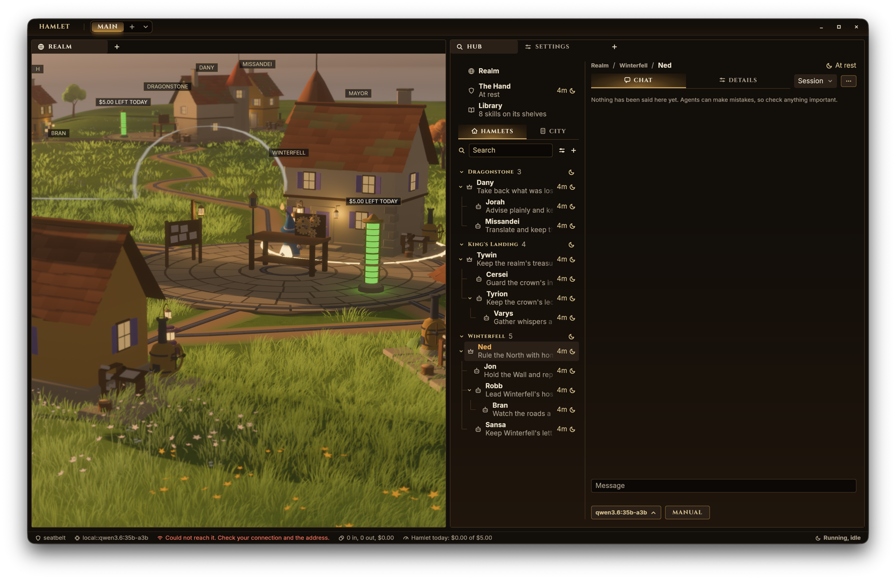

<p align="center">
  <picture>
    <source media="(prefers-color-scheme: dark)" srcset="brand/logo/hamlet-logo-transparent.png">
    
  </picture>
</p>

# Hamlet

[](https://github.com/voxell-tech/hamlet#license)
[](https://github.com/voxell-tech/hamlet/actions)
[](https://discord.gg/hJjjTkXRKw)
[](https://discord.gg/Mhnyp6VYEQ)

**Hamlet** is an agent orchestrator. You lead hamlets of AI agents and
watch them work in a small 3D world where each agent is a robot. Free
and open-source forever.

<p align="center">
  
</p>

## Features

- **The Hand**: You are the chief and talk to the Hand, your own agent
  above every hamlet. It founds hamlets, hires into them and starts
  workers for small jobs.
- **Scholars that learn**: Every agent but the Hand and its workers is a
  hire of a scholar, a git repository of a character, memory and skills.
  A hire works on a branch of its own, and what it learns is merged into
  its scholar's `main`. Tag versions, pin a hire to one, revert or fork a
  scholar.
- **Hamlets that run themselves**: A hamlet's mayor hires, leads and lays
  the roads its agents' letters and questions travel along. Leads review
  their hires' work.
- **Agents that grow**: An agent starts with a sandboxed shell, a file
  editor and its memory, and writes its own skills. A librarian shelves
  the useful ones in a library every agent shares, and an idle scholar
  dreams to tidy what it knows.
- **Point a hamlet at your code**: Give a hamlet a folder and its agents
  work in it, as a coding agent does.
- **You stay in charge**: In manual mode every edit and command waits for
  your approval. In auto mode the sandbox keeps writes inside the folder.
  An agent may object to an instruction, and the chief rules on it and can
  overrule anything.
- **Many hamlets at once**: Hamlets sit side by side, each with its own
  agents, budget and folder.
- **Any model**: Any OpenAI-compatible endpoint, a local
  [Ollama](https://ollama.com) by default.

## New here?

Hamlet's words in one minute:

| Word | Meaning |
| --- | --- |
| **Chief** | You, the human who leads. |
| **Realm** | Everything one server keeps: its chiefs, the Hand, the scholars and the hamlets. |
| **Hand** | Your own agent, always there, above every hamlet. |
| **Scholar** | Who an agent is: a git repository of its character, memory and skills. |
| **Hamlet** | Hires of scholars with a budget and, optionally, a folder to work in. |
| **Mayor** | The hire that leads a hamlet. |
| **Road** | A path between two agents that their letters travel along. |

The shortest path to seeing it work:

1. [Install Hamlet](#install), or follow the [Quick start](#quick-start)
   to build it from source.
2. Give Hamlet a model: an API key, a local model endpoint, or a sign-in
   (see [Models and credentials](#models-and-credentials)).
3. Talk to the Hand and say what you want done.
4. Watch the agents work. Approve edits and commands as they ask.

Not ready to install anything? [Try it without
installing](#try-it-without-installing) uses a scratch folder that leaves
your real files alone.

## Status

Early and moving fast.

- **`hamlet_server`** (Rust) owns the realm: the agents, scholars'
  repositories, roads, letters, library, approvals and budgets.
- **pi harness** (Node processes) owns conversations and model calls.
- **The window** is a protocol client. Closing it stops no agent.
- **Tests** use faux and loopback providers. They do not establish
  exhaustive behavior or platform coverage.

## Install

Download the file for your system from the
[latest release](https://github.com/voxell-tech/hamlet/releases/latest).
Each includes everything Hamlet needs, Node too.

| System | File | Then |
| --- | --- | --- |
| macOS (Apple Silicon) | `Hamlet-<version>.dmg` | Open it and drag Hamlet onto Applications. |
| Ubuntu, Debian, Mint | `hamlet_<version>_amd64.deb` | Open it with Software Install (App Center). |
| Fedora | `hamlet-<version>-1.x86_64.rpm` | Open it with Software. |
| Windows (x64) | `Hamlet-<version>-Setup.exe` | Run it. Until Windows has a sandbox, the app cannot start the server; see [Tools and platforms](#tools-and-platforms). |

Then open Hamlet from your applications. It starts its server and opens
the window, which walks you through choosing a model. If Hamlet cannot
start, it says why in a dialog.

> [!NOTE]
> Until a release is signed, macOS refuses the app the first time. Open
> **System Settings → Privacy & Security** and choose **Open Anyway**
> beside Hamlet. Windows may say it protected your PC: choose
> **More info**, then **Run anyway**.

The archives beside them hold the same programs for a terminal; see
[releases](docs/releases.md).

## Quick start

You need Rust, git and Node **24.1.0** (pinned in `harnesses/pi/.nvmrc`).
From the repository root:

```sh
cargo xtask install
hamlet
```

This installs pi's packages, puts `hamlet`, `hamlet_server` and
`hamlet_app` in `~/.cargo/bin`, and starts your realm in `~/.hamlet`.

> [!NOTE]
> A source install uses the checkout's `harnesses/pi/`. Keep the checkout,
> and run `cargo xtask install` again after pulling.

## Try it without installing

Use a scratch folder so your real `~/.hamlet` is untouched:

```sh
HAMLET_HOME=/tmp/hamlet-try cargo xtask dev
```

`dev` builds the local server and window, starts the server on a free
port, and opens the window. No global npm command is needed.

- The realm is kept between runs. The window's files go in
  `$HAMLET_HOME/window`.
- Closing the window leaves `hamlet dev` serving. Ctrl-C stops it.
- `--hot` builds a window that reloads saved shaders and tuning files.
- To run other commands without installing, use
  `cargo run -p hamlet_cli -- <command>`.

### Server and window separately

After installing, use two terminals to keep the server apart from the
window:

```sh
HAMLET_HOME=/tmp/hamlet-try hamlet server
```

```sh
# In the other terminal:
HAMLET_HOME=/tmp/hamlet-try HAMLET_VIEW=/tmp/hamlet-try/window hamlet window
```

`hamlet chat` is the terminal client. `hamlet --help` lists the commands.

## Configuration

### Models and credentials

Use an API key, a local model endpoint, or sign in with ChatGPT or
OpenRouter. Credentials stay on the server, and subscription refreshes are
saved there before the harness continues.

### Tools and platforms

- Local tools need Seatbelt on macOS or working bubblewrap on Linux.
- Settings can select a remote workspace for the agents' tools and
  lodges. It takes effect on restart and never falls back to local
  execution.
- Windows has no sandbox. A Windows server starts only in insecure
  mode, with `hamlet --insecure`, and agents' commands then reach whatever
  your account can. Agents get `powershell`, and `bash` where Git for
  Windows is installed. Linux and macOS refuse `--insecure`.
- The window can connect to another machine's server.

### Environment variables

| Variable | Meaning |
| --- | --- |
| `HAMLET_HOME` | The folder the server keeps its realm in. Defaults to `~/.hamlet`. Use a scratch folder when trying things out. |
| `HAMLET_VIEW` | Where the window keeps its size, layout and look. Defaults to the OS's config folder for Hamlet. Set it to a scratch folder when running the window outside `hamlet dev`. |
| `HAMLET_SERVER_BIN` | An existing server binary. Skips the server build in `dev`. |
| `HAMLET_APP` | An existing window binary. Skips the window build in `dev`. |
| `HAMLET_SERVER` | A remote WebSocket URL, never an executable. |
| `HAMLET_PI_HARNESS` | Pi's `src/main.ts`. |
| `HAMLET_NODE` | A Node executable. |

Installed commands look for the server and window beside the CLI, then on
`PATH`. Without `HAMLET_PI_HARNESS`, the server prefers a sibling
`pi/src/main.ts`, then the macOS bundle's `Contents/Resources/pi/src/main.ts`,
then the build checkout's harness. Without `HAMLET_NODE`, it prefers the
Node a release ships beside it, then Node on `PATH`.

An installed app opens `hamlet_launch`, which starts or reuses the server
and opens its sibling window, and shows a failure in a dialog.

## Using the window

| To | Do this |
| --- | --- |
| Slide the ground | Drag it |
| Turn | Drag with the right button |
| Zoom | Scroll |
| Talk to an agent | Click its robot |
| See what can be done to something | Right-click it |

## Working on the code

`vendor/fynix` is a git submodule: clone with `--recurse-submodules`, or
run `git submodule update --init vendor/fynix` once. `cargo xtask`
fetches it itself.

`cargo xtask check` runs the same checks as CI, on your own system. CI
runs them on Linux, macOS and Windows, so it can still catch what fails
only on another system. `cargo xtask help` lists every task.

- `rust-toolchain.toml` follows the latest stable, no older than
  `rust-version` in `Cargo.toml`. If cargo says your compiler is too old,
  run `rustup update stable`.
- Formatting uses the latest nightly (`rustup update nightly`).
- `deny` needs `cargo install --locked cargo-deny`.

Where to read next:

- [`docs/tour.md`](docs/tour.md) is the map of the code.
- [`docs/`](docs/README.md) lists every page.
- [`AGENTS.md`](AGENTS.md) has the rules for working here.

## Join the community!

You can join us on the [Hamlet discord server](https://discord.gg/hJjjTkXRKw),
or on the [Voxell discord server](https://discord.gg/Mhnyp6VYEQ) for
everything we make.

## License

`hamlet` is dual-licensed under either:

- MIT License ([LICENSE-MIT](LICENSE-MIT) or
  [http://opensource.org/licenses/MIT](http://opensource.org/licenses/MIT))
- Apache License, Version 2.0 ([LICENSE-APACHE](LICENSE-APACHE) or
  [http://www.apache.org/licenses/LICENSE-2.0](http://www.apache.org/licenses/LICENSE-2.0))

This means you can select the license you prefer! This dual-licensing
approach is the de-facto standard in the Rust ecosystem and there are
[very good reasons](https://github.com/bevyengine/bevy/issues/2373) to
include both.
