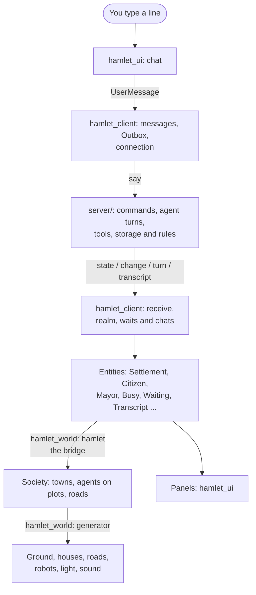

# A tour of the code

Where things are and where to change them. For what Hamlet is and how to
run it, read [`README.md`](../README.md) first. For the rules of working
here, [`AGENTS.md`](../AGENTS.md).

## The idea in one paragraph

Agents run on the TypeScript server in `server/`, on pi-durable, with their
conversations and records in the home's storage and their writable files
in houses. The Rust window is a client: `hamlet_client` fills Bevy entities
from protocol v0 over one authenticated WebSocket. The world and panels
read those entities and send the chief's deeds back to the server. The
server owns the rules and the truth; the window keeps only its own view
files, and closing it stops no agent.

## How a change travels



## The crates

All are under `crates/`. The `hamlet-app` binary and the examples are the
root package, `hamlet`. The window's crates are:

| Crate | What it is |
|---|---|
| `hamlet_protocol_gen` | Generates Rust protocol types from `server/protocol.schema.json`; run with `cargo run -p hamlet_protocol_gen` |
| `hamlet_protocol` | Checked-in protocol v0 types in `src/v0.rs`, with a test that catches schema drift |
| `hamlet_client` | The client core: the connection, Outbox, received realm, waits and watched chats. Bevy app/ECS, no rendering |
| `hamlet_desktop` | The window's machine: kept awake while a received agent is busy, file and link openers, temporary editor files, the folder dialog and the app's icon |
| `hamlet_assets` | The files under `assets/`, built into the app and loaded as Bevy assets |
| `hamlet_vfx` | The visual effects: what each is and how it plays |
| `hamlet_world` | The 3D world, drawn from the client's entities |
| `hamlet_ui` | The window: panels, menus, chat and pointer around the world |
| `hamlet_testing` | Scratch folders and protocol-value builders for offline tests |

The Rust runtime crates remain compiled and tested until step 7. No window
crate depends on them; `tests/window_is_a_client.rs` guards that boundary.
They are porting references, described in [`core.md`](core.md):

| Crate | Retained runtime part |
|---|---|
| `hamlet_sandbox` | Per-platform process sandboxes |
| `hamlet_model` | Model clients, settings, catalogue and session logs |
| `hamlet_home` | The Rust home's layout, charter, prompt, limits and starter skills |
| `hamlet_rules` | Records and rules over them, without Bevy |
| `hamlet_core` | Runtime plugins: agents, sessions, tools and oversight |

## The server

The active runtime is `server/`, its own Node package. Paths in this
section are under `server/src/`. Recorded faux sessions in
`server/test/frames/` are checked by the server tests and replayed by the
Rust client tests.

Each concept has an entry `<name>.ts` and, when needed, implementation
files in `<name>/`. Outside code imports the entry; internals import
siblings and other entries. Entries use named re-exports, with no
`index.ts`. Tests stay flat in `server/test/` and may exercise internals.
The directly importable dependency leaves and shared conversation core
are listed in
[`server/docs/coding-standards.md`](../server/docs/coding-standards.md#modules-and-folders).
Their value dependencies cannot reach composed entries, even indirectly.
The structure test checks that boundary and forbids value-import cycles.

| Entry and folder | Owns | Interface |
|---|---|---|
| `home.ts`, `home/` | Composition, layout, credentials, lock, clock and part lifetimes | `openHome` returns a `Home` with the harness and owned capabilities; `Part` installs work and its close handle |
| `record.ts`, `record/` | Agent identity, membership, names, local roads, the office and votes' records | Transactional `admit`, `depart`, `restore`, `moveMember`, `layRoad`, `takeUpRoad`, `seat` and `mayDecide`; typed refusals and memoised mayor tools |
| `agents.ts`, `agents/` | Agent creation and model choices, departure, restoration, erasure, merging and splitting | `Agents`, `Leaving`, `Merging` parts and the chief's agent and road deeds |
| `realm.ts`, `realm/` | Places, chief access, addresses, founding, closing and agreements across hamlets | Realm deeds and views; `livingAgent` for chiefs, `resolveAddress` for tools and `findInState` for clients |
| `letters.ts`, `letters/` | Letters, questions, peer conversations and their counts | `Letters`, `askAgent`, `conversationViews` and `PeerStatistics` |
| `votes.ts`, `votes/` | Calling votes, hearings, ballots and execution | `Votes`, `vote`, `votes`, `overturn` and `mayor`; record views re-exported from `record.ts` |
| `library.ts`, `library/` | Shared skills, starters, librarian calls and publication | `Librarian`, `unshelve`, `libraryView`, `installStarters` and `libraryPart` |
| `house.ts`, `house/` | House notes, skill papers, gifts and confined tree work | Home-owned `Houses.of` readers; `uploads`, `give`, `giftSkill`, `stage`, `deliver`, `list`, `remove` and `erase` |
| `environment.ts`, `environment/` | Tool reach, cached environments, the work folder and its mode | `Confinement`, `agentEnv`, `houseReader`, `treeWorker`, `toolRunner`, `insideHouse`, `folder` and `setMode` |
| `sandbox.ts`, `sandbox/` | File helpers and platform confinement with Seatbelt or bubblewrap | `SandboxEnv`, `Sandbox`, `platformSandbox` and `probeSandbox`; policies are built by `environment.ts` |
| `scrub.ts`, `scrub/` | Credential scrubbing of stored text, values, streams and shell output | `secretsFrom` builds `Home.secrets`; `words`, `value` and `shell` scrub through the capability; `Scrubber` handles streams |
| `oversight.ts`, `oversight/` | Waits, rulings, refusal history, trust, questions and objections | `open`, `forAgent`, `forChat`, `ended` and `view` query waits; `raise`, `settle`, `lapse` and `Objections` change them |
| `gate.ts`, `gate/` | Tool admission, standing permissions and chief answers | `Gate`, `answer`, `answerWords` and `closeGate`; the hook uses the pure `rule` in `gate/rule.ts` |
| `chats.ts`, `chats/` | Conversations, their deeds, configuration, turns, errands, reflection and follow-up work | `current`, `past`, `history`, `start`, `resume`, `carryOn`, `takeBack`, `stop`, `reflect` and `runErrand`; `Talk` supplies `Home.follow.settled` |
| `transcript.ts`, `transcript/` | Watched and paged conversations, their item fold and read-only peers | `watchChat`, `pageChat`, `turnTools`, `agentConversation` and `requireWritable` |
| `state.ts`, `state/` | Realm state and changes composed from owners' views, plus activity | `stateOf` and `watchState`; watch failures go to the supplied reporter |
| `spend.ts`, `spend/` | Ledger, accounting, budgets, affordability and spend reports | `booksIn` counts within a transaction, `booksOf` reads through a commit, `canSpend` checks hamlet and task caps; `Budget`, `reportOf` and `chargeRoad` |
| `limits.ts`, `limits/` | Hamlet limits and their editing | `LimitsSchema`, `parseLimits`, `limitsOf` and `editLimits` |
| `models.ts`, `models/` | Model links, provider state, catalogue, settings, credentials' use and sign-ins | Home-owned `ModelHome` syncs, refreshes, edits, lists providers, signs in and checks connections; `models/faux.ts` supplies offline models |
| `prompt.ts`, `prompt/` | Charter, character, notes, skills, hamlet brief and prompt inspection | `Prompt`, `HamletBrief`, `editCharter`, `charterOf` and `told` |
| `tools.ts`, `tools/` | The six built-in file and shell tools, confined runs and tool failures | `Tools`, `runConfined`, `leaveFor`, `toolFailureText` and `toolDefect` |
| `hand.ts`, `hand/` | Tools added by hand, manifest parsing and watching | `Hand`, `parseManifest`, `manifestFaultText`, `reservedNames` and `ManifestsDoc` |
| `say.ts` | Dispatch of the chief's typed line | `say` returns a receipt or typed chief failure, or admits agent work without an immediate outcome |
| `server.ts`, `server/` | Protocol request routing, reads, edits, envelopes and sign-in sessions | `serveHome`; `server/envelope.ts` correlates, renders and scrubs receipts and failures with `replyFor` and `faultFor` |
| `cli.ts`, `cli/` | Serving, discovery, terminal clients, editor, sign-in and window launch | `main(argv, env, io)` returns an exit code on caller-owned streams; `server/bin/hamlet` invokes it |
| `protocol.ts` | Protocol v0 schemas, types and parsing | `parseClient`, `parseServer`, `checkEdit`, `protocolSchema` and the shared transcript `applyOp` |
| `connection.ts` | Authenticated WebSocket transport and the connection defect path | `serve`, `connect` and `Client` |
| `commands.ts` | The advertised command table and typed command parsing | `COMMANDS`, `readCommand` and `commandFailureText` |
| `settings.ts` | Settings, environment overrides and pure model choice | `SettingsDoc`, `settingsOf`, `readOverrides`, `modelRef` and `choose` |
| `change.ts` | Bounded edit previews and text excerpts | `changeOf`, `changeBetween`, `linesOf` and Unicode `clip` |
| `result.ts` | The shared success or failure shape | `Result`, `ok` and `err` |

`cli/service.ts` owns bare start, stop and status through `serviceCommand`.
It checks the published process and authenticates with the home's token,
starts a detached server on a free port, and opens a detached window through
`cli/window.ts`'s `launch`. `cli/process.ts`'s `startProcess` owns child streams
and detached sessions. `cli/serving.ts`'s `serve` publishes the URL, process
ID and ISO `started` time in `server.json`, and closes the server on SIGTERM.
The background server appends output to the home's `server.log`.

`cli/client.ts`'s `readServer` validates `ServerRecord` and returns a
`DiscoveryFailure` for an unreadable record. `reachHome` supplies its token;
`connectChief` authenticates, with an optional abort signal that releases
the socket through `connection.ts`'s `connect`. `home/credentials.ts`'s
`Credentials.readExisting` reads without creating a file, so failed starts
can scrub log tails without changing credentials. `server/test/one-command.test.ts`
checks the lifecycle with scratch homes and fake windows, and tracks every
detached server for cleanup after each test.

The record's operations live in `record/membership.ts`, `roads.ts` and
`office.ts`; `document.ts` holds the records and stable identities,
`names.ts` their words and realm-wide name uniqueness, `refusals.ts` the
refusal family and `tools.ts` the replay-safe tool wrappers. Agent lifecycle work composes these operations.
Merge planning is in `agents/merge-plan.ts`, confined file application and
journal recovery in `agents/merge-files.ts`, and tools, deeds and house
holds in `agents/merging.ts`. Votes keep their durable phases in
`votes/task.ts` and pure wording, tallying and evidence checks in
`votes/words.ts`.

Conversation deeds live in `chats/deeds.ts`; `chats/follow.ts` owns the
follow pipeline and its close work. Call `Home.follow.settled` to wait for
admitted follow-up work. Closing that part calls `gate.ts`'s `closeGate`
to refuse new reflection approvals. Model and role configuration lives in
`chats/configure.ts`; pure model selection lives in `settings.ts`.

`Home.confinement` owns cached tool environments; `Home.houses` owns the
read-only notes and skill readers and closes them with the home. `House.notes`
returns a classified read; `House.notesText` supplies optional prompt text,
and `House.build` constructs its house. `realm/founding.ts` owns the shared
hamlet-count cap for founding and restoration. `sandbox/policy.ts` names
process resource limits `executionLimits`; `limitsOf` belongs to hamlet
limits.
`Home.modelHome` owns model state; `Home.models` exposes its pi-ai models
to the harness. `server/sign-in.ts` owns each client's interactive sign-in
sessions and cancellation, using `ModelHome.login`.

The state includes departed agents, roads, votes and closed hamlets.
Changes to the shelf, the closed list or the set of hamlets shrinking
replace the whole state; the client reconciles it without losing surviving
entities.

## Inside the Rust crates

Inside a crate, a module with several subjects is a file and a folder of
the same name, and each file opens with a line saying what it holds. Read
`lib.rs` for the list.

`hamlet_world` has one folder for each thing in the world: `generator/`
(land, towns, houses, roads and traffic from a seed), `keeper/` (the
robots), `chief/` (the wizard and its Hearth), `hand/` (what the chief does
by hand), `pick/` (pointing, selecting and the camera) and `sound/`.
`hamlet_ui` has one file or folder for each panel, and `theme.rs`,
`looks.rs`, `feel/` and `icons.rs` for how they look.

Names to keep apart:

- `hamlet_client/src/realm.rs` holds the received hamlets and agents;
  `chats.rs` holds the watched conversations.
- `server/src/record.ts` holds the server's hamlet record and agent identity.
  `hamlet_world/src/hamlet.rs` is the bridge that puts received hamlets
  into the world.
- `chief.rs` is the wizard in `hamlet_world` and the chief's panel in
  `hamlet_ui`; `Chief` in `hamlet_client` is the server's chief name.
- `hand.rs` is the hand in `hamlet_world`; `orders.rs` sends its deeds to
  the server.

## Where do I change...

Rust crate paths are under `crates/`; `server/` paths are from the
repository root.

| To change | Go to |
|---|---|
| What an agent is told every turn | `server/src/prompt.ts`, `prompt/`; composition is in `home/parts.ts`; the charter is `server/assets/charter.md` |
| The tools an agent has | `server/src/tools.ts`, `tools/`; the mayor's tools in `server/src/agents/mayor.ts` |
| A chief's slash command | `server/src/commands.ts`; the server advertises supported deeds in `state.deeds` |
| A conversation deed or follow-up work | `server/src/chats/deeds.ts`, `chats/follow.ts`; wait through `Home.follow.settled` |
| Membership, names, road or office invariants | `server/src/record.ts`, `record/membership.ts`, `record/names.ts`, `record/roads.ts`, `record/office.ts` |
| Chief-facing failure wording and reply kinds | `server/src/server/envelope.ts` chooses the owner's renderer and scrubs the envelope |
| Notes, skill readers or gifts | `server/src/house.ts`, `house/skills.ts`, `house/gifts.ts`, `house/trees.ts`; readers belong to `Home.houses` |
| The server command or terminal clients | `server/src/cli.ts` (`main`), `cli/`; `server/bin/hamlet` is the executable |
| What needs the chief's approval | `server/src/gate.ts`, `gate/call.ts`, `gate/rule.ts`, `gate/standing.ts`; waits and queries in `oversight.ts` |
| What an agent's commands may touch | `server/src/environment.ts` builds confinement; `sandbox.ts`, `sandbox/` run it; [`sandbox.md`](sandbox.md) describes the reach policy |
| The folder a hamlet works on | `server/src/environment.ts`, `environment/work.ts`; the panel is `hamlet_ui/src/folder.rs` |
| The workbench and its clockwork on a common | `hamlet_world/src/works.rs` |
| Agents, roads and model choices | `server/src/agents.ts`, `agents/mayor.ts`; membership and road rules in `record/`, model choice in `settings.ts` |
| Letters, questions and watching peer chats | `server/src/letters.ts`, `letters/peers.ts`, `transcript.ts`; `hamlet_ui/src/inspector/conversations.rs` |
| Removal, merging and restoration | `server/src/agents.ts`, `agents/leaving.ts`, `agents/merging.ts`, `agents/merge-plan.ts`, `agents/merge-files.ts`; `hamlet_client/src/realm.rs` supplies departure components |
| Votes and the mayor's office | `server/src/votes.ts`, `votes/task.ts`, `votes/words.ts`; office rules and vote records in `record/office.ts`; the window's `hamlet_ui/src/overview/record.rs` |
| The shared library | `server/src/library.ts`, `library/librarian.ts`; `hamlet_ui/src/inspector/gone.rs` |
| Instructions and objections | `server/src/chats/instructions.ts`, `oversight/objections.ts` |
| Founding, closing and dealings across hamlets | `server/src/realm/founding.ts`, `dealings.ts`; [`society.md`](society.md) |
| Spending and limits | `server/src/spend.ts`, `spend/afford.ts` (`canSpend`), `spend/ledger.ts` (`booksIn`); limits in `limits.ts`, `limits/edit.ts` |
| Models, their prices and who may run them | `server/src/models.ts` (`ModelHome`), `models/catalogue.ts`, `models/providers.ts`; pure choice in `settings.ts` |
| The model harness | `server/src/home.ts`, `chats/turn.ts`; pi-durable owns the model calls |
| Signing in with ChatGPT to run models on the chief's plan | `server/src/server/sign-in.ts` for client sessions; `models.ts`, `models/logins.ts`, `home/credentials.ts` for providers and credentials |
| A starter skill | `server/assets/starters/<name>/SKILL.md` |
| The protocol or its Rust types | `server/src/protocol.ts`; export with `npm run schema`, then `cargo run -p hamlet_protocol_gen` |
| Connection, reconnection or received components | `hamlet_client/src/connection.rs`, `realm.rs`, `waits.rs`, `chats.rs` |
| A panel | Its file in `hamlet_ui/src/` |
| The right-click menu | `hamlet_ui/src/world_menu/items.rs` |
| A colour in the panels | `assets/theme.toml`, its fields in `hamlet_ui/src/theme.rs` |
| How a control looks or feels | `hamlet_ui/src/looks.rs`, `feel/`; [`ui-warmth.md`](ui-warmth.md) |
| An icon | `hamlet_ui/src/icons.rs`; [`icons.md`](icons.md) |
| A colour in the world | `assets/palette.toml` |
| A size, speed or timing | `assets/world.toml`, `vfx.toml`, `ui.toml`. What each value means is beside its field in the code |
| The height something stands at | `LandData::surface`: the ground as it is drawn, never the smooth `height` |
| How a house looks | `hamlet_world/src/generator/house.rs` |
| How a robot moves | `hamlet_world/src/keeper/acts/`; [`robots.md`](robots.md) |
| An effect | `hamlet_vfx/src/`; when it is set off, `hamlet_world/src/generator/magic.rs` |
| A sound or the music | `hamlet_world/src/sound/`; [`sound.md`](sound.md) |
| The camera | `hamlet_world/src/pick/camera.rs` |
| The wizard or the Hearth | `hamlet_world/src/chief/`; [`chief.md`](chief.md) |
| The window's saved layout, size and look | `hamlet_ui/src/remember.rs`, `window.rs`, `hamlet_world/src/chief/look.rs`; files under `HAMLET_VIEW` |
| Final editor saves and closing the window | `hamlet_desktop/src/editor.rs`, `hamlet_ui/src/saving.rs`, `window.rs` |
| The server's settings or chief documents | `server/src/settings.ts`, `server/src/server/reads.ts`, `server/src/server/edits.ts`; the panels send protocol requests |

## Tuning while the app runs

The files under `assets/` are built into the app. With the `hot-reload`
feature they are also watched: save a change and the running app takes it.

```sh
cargo build --bin hamlet-app --features hot-reload
HAMLET_HOME=/tmp/hamlet-try HAMLET_APP="$PWD/target/debug/hamlet-app" hamlet dev
```

Three things do not follow a saved change: the `[generator]` section of
`world.toml`, since the land keeps the settings it was built from; the
colour of a mesh that is already built; and the charter, which is owned by
the server and edited through its protocol.

A file that cannot be read is reported and the last good values stay.

## Seeing your work without a window

These draw to files and open nothing:

| Command | Shows |
|---|---|
| `cargo run --example ui_gallery -- --scene <name> --out <dir>` | One panel scene. `examples/ui_gallery/main.rs` lists the scenes |
| `cargo run --release --example far_lands -- --out <dir>` | The land, many towns, a town being moved; `--bench` times it |
| `cargo run --example chief_sheet -- --out <dir>` | The wizard, its looks, a Wickstep, the library |
| `cargo run --example cursor_sheet` | Every cursor |
| `cargo run --release --example sound_sheet` | Every sound and the music, as WAV files |

`style_test` (one fixed scene and the robots' motions) and `town_gen` (the
generated world, grown from the keyboard) open a window.

Run the pair against a scratch home, never your own:

```sh
HAMLET_HOME=/tmp/hamlet-try hamlet dev
```

`npm link` in `server/` installs `hamlet`; use its `.nvmrc` Node version.
An old Cargo-installed `hamlet` can shadow it on PATH. `hamlet dev` sets
`HAMLET_VIEW=<home>/window`; when opening a window yourself, set a scratch
`HAMLET_VIEW` too. A server can outlive any number of windows; Ctrl-C in
the `hamlet dev` terminal stops the server.
