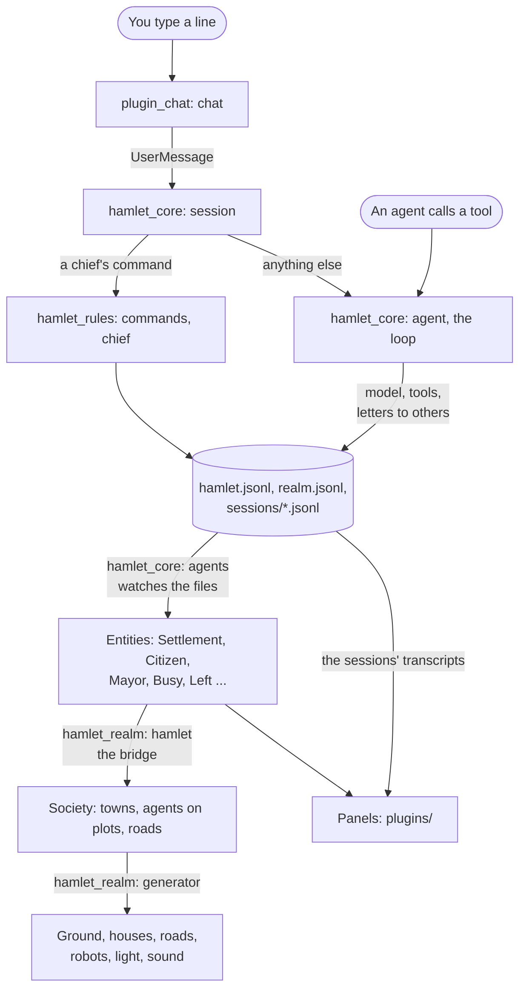

# A tour of the code

Where things are and where to change them. For what Hamlet is and how to
run it, read [`README.md`](../README.md) first. For the rules of working
here, [`AGENTS.md`](../AGENTS.md).

## The idea in one paragraph

Agents are folders and append-only records on disk. The core runs their
loops and writes the records. Everything shown is rebuilt from the records:
first as entities, then as a small model of towns, houses and roads, then
as a drawn world with panels around it. Nothing on screen is the truth; the
files are.

## How a change travels



## The crates

All are under `crates/`, and each depends only on those above it in this
table. The binary and the examples are the root package.

| Crate | What it is |
|---|---|
| `hamlet_sandbox` | Per-platform process sandboxes |
| `hamlet_model` | The model client, its settings, the catalogue of models, the session log |
| `hamlet_home` | A home on disk: its layout, charter and prompt, the chief's limits, the starter skills |
| `hamlet_base` | What every layer shares: `HomeDir`, the home the app opened, `Tokio`, the runtime background work runs on, `Busy`, the mark of an agent at work, and the rules of a plugin's names (`plain`, `joinable`) |
| `hamlet_rules` | The hamlet's record and the rules over it. Plain files and functions, no Bevy |
| `hamlet_core` | The runtime: agents, sessions, tools and oversight, each module with the `plugin` of its own systems. No rendering |
| `hamlet_desktop` | The machine the app runs on: kept awake while an agent works, its programs that show a file or a link, its folder and file dialogs and the app's icon |
| `hamlet_assets` | The files under `assets/`, built into the app and loaded as Bevy assets |
| `hamlet_offscreen` | An app that draws into an image with no window and saves a still. The examples and the plugin harness draw with it |
| `hamlet_vfx` | The visual effects: what each is and how it plays |
| `hamlet_realm_api` | What the window and its plugins read of the realm and ask of it: the things chosen and the camera brought to one (`pick`), the chief's look (`chief`), the palette and an agent's `RobotPaint`, the hand's hold, the quality and the sky's hour (`sky`), the panels' sounds and the chief's choice of sound (`sound`), the orders (`orders`: decrees, carrying a hamlet, the library or the Hearth, giving a skill), and the realm as a plugin reads it (`survey`) |
| `hamlet_realm` | The 3D world, drawn from the core's entities. It keeps the read models of `hamlet_realm_api` and answers its events |
| `hamlet_sdk` | What a plugin is built with: the plugin types, commands, menu lines, context menu items, inspector tabs, settings pages and keys, the theme, looks and icons, the dock's panels. It does not depend on the core: its read models of the agents are plain data |
| `hamlet_agents_api` | What a plugin reads and does about the agents: the systems that keep the SDK's read models from the core, the chat the window shows (`Me`), the questions' card, the words for an agent's state, the petitions of plugins put in the chief's queue, the core's tools and turns a host of plugins reaches, and the core's and the rules' types a plugin reads (`session`, `oversight`, `model`, `library`, `hamlet`) |
| `hamlet_chat_api` | What other plugins use of the chat: sending to it and pointing it at an agent, the deeds that ask the chief first, the link under the pointer, and the chat's views, which `plugin_chat` sets |
| `hamlet_limits_api` | What other plugins use of the limits: the panes of the home's models and of each hamlet's rules, which `plugin_limits` sets |
| `hamlet_ui` | The frame of the window: the dock and its saved layout, the window's chrome and states, the pointer, the hover card and the panels' sounds. What fills it is plugins |
| `hamlet_openui` | Panels written in Hamlet's panel language: the components, the evaluation into a panel tree, state, actions and the data plugin. See [`panels.md`](panels.md) |
| `hamlet_wasm` | The host of the installed WASM plugins, behind the binary's `wasm` feature. See [`wasm.md`](wasm.md) |
| `hamlet_native` | The host of the installed native plugins, behind the binary's `native` feature, and the contract a library keeps. See [`native.md`](native.md) |
| `hamlet_guest` | What a WASM plugin is written with: the interface bindings, the `Plugin` trait, the tree builder and the helpers that keep its state and its storage |
| `hamlet_harness` | Runs a plugin headlessly against made-up state: clicks, typed text, grants, the tree of each panel as text and a picture of it. Behind its `wasm` feature. See [`authoring.md`](authoring.md) |

The plugins are under `plugins/`: `plugins/all` is `hamlet_plugins`, which
lists them, and each other folder is one plugin crate. The binary is a list
of plugins: the layers `plugin_agents`, `plugin_hamlets` and `plugin_realm`
(each adds the modules of the engine crate of the same subject, and none can be switched
off), then the frame of the window (`hamlet_ui`), the chat and the limits
(`plugin_chat`, `plugin_limits`), what fills the frame
(the realm's view in `plugin_realm`, `plugin_menus`, `plugin_status`,
`plugin_welcome`) and
the panels. See [`sdk.md`](sdk.md). A plugin built
for WASM is under `guests/`, in a workspace of its own. A native plugin is
a member of the workspace under `native/`, left out of the default members,
or a folder outside built against an SDK kit (`scripts/make-native-sdk.sh`,
or `scripts/fetch-native-sdk.sh` for a release). `rust-toolchain.toml` pins
the compiler, which a native plugin and every CI and release job share.

Inside a crate, a module with several subjects is a file and a folder of
the same name, and each file opens with a line saying what it holds. Read
`lib.rs` for the list.

`hamlet_realm` has one folder for each thing in the world: `generator/`
(land, towns, houses, roads and traffic from a seed), `keeper/` (the
robots), `chief/` (the wizard and its Hearth), `hand/` (what the chief does
by hand), `pick/` (pointing, selecting and the camera) and `sound/`.
Each module has a `plugin` of its own systems, and the crate has no plugin
of the whole. `plugin_realm::world` (`plugins/realm/src/lib.rs`) is a flat
list of them, scene first (settings, palette, play, sound, debug, sky,
stage, keeper, stock), then the generator, then what the chief does in it,
then `hamlet.rs` and `survey.rs`; the app adds it through `plugin_realm`. An
app that wants only the scene adds the first group itself, as the style
test does; the town generator adds it with `generator::plugin` and an
`Origin` for its seed. The core is the same: `plugin_agents` and
`plugin_hamlets` add its modules ([`sdk.md`](sdk.md), The layers).
`hamlet_ui` is the frame of the window: the dock (`dock.rs`, `remember.rs`),
the root it is mounted in with the parts plugins add to the frame
(`root.rs`), the window's chrome and states (`chrome.rs`, `window.rs`, and
`commands.rs` with Run in Background and Quit), the cursor, the hover card
and the sounds of the panels. `widgets/` holds what the panels are drawn
with: `feel/` and `tuning.rs`. Everything else in the window is a plugin:
the world's panel and camera (`plugins/realm/src/view.rs`), the menus and the
right-click menu (`plugins/menus`), the status bar (`plugins/status`), the
first-run screen (`plugins/welcome`), and the Inspector, the Settings, Needs
You and Skills. How things look (`theme.rs`, `looks.rs`, `icons.rs`,
`platform.rs`), `tabs.rs` and `checks.rs` are in `hamlet_sdk`; `roll.rs` and
`words.rs` in `hamlet_agents_api`.

Names to keep apart:

- `hamlet_core/src/agent.rs` is the loop one agent runs. `agents.rs` is
  every agent as an entity.
- `hamlet_rules/src/hamlet.rs` is a hamlet's record on disk.
  `hamlet_realm/src/hamlet.rs` is the bridge that puts hamlets into the
  world.
- `chief.rs` is a chief's commands in `hamlet_rules`, the wizard in
  `hamlet_realm`, who a chief is and their look in `hamlet_realm_api`, the
  mascot kept beside the chat in `plugin_realm::view` and the chief's page
  in `plugin_inspector`.
- `hand.rs` is the hand in `hamlet_realm`. In `hamlet_realm_api` it is what
  the hand holds, for the cursor.

## Where do I change...

Paths are under `crates/`.

| To change | Go to |
|---|---|
| What an agent is told every turn | [`prompt.md`](prompt.md); the charter is `assets/charter.md` |
| The tools an agent has | `hamlet_core/src/tools/`; the hamlet's own in `hamlet_core/src/agent/hamlet_tools.rs` |
| The questions an agent asks the chief | `hamlet_rules/src/chief/asking.rs`; their card, in Needs You and the chat, in `hamlet_agents_api/src/asking.rs` |
| Selecting and copying text in the panels | `plugins/chat/src/select.rs`; [`chat.md`](chat.md) |
| A chief's slash command | The table `ALL` in `hamlet_rules/src/commands.rs`, which names who carries it out. It is not a `Command` entity: see [`sdk.md`](sdk.md) |
| What needs the chief's approval | `hamlet_core/src/oversight/danger.rs` |
| A plugin's petition: installing it, letting it use more, removing it | `hamlet_core/src/oversight/plugin.rs`, `hamlet_sdk/src/capability/petition.rs`, `install.rs`, `hamlet_agents_api/src/petition.rs` (between the two); removing it, `hamlet_wasm/src/uninstall.rs`; [`permissions.md`](permissions.md) |
| What an agent's commands may touch | `hamlet_sandbox/src/`; [`sandbox.md`](sandbox.md) |
| The folder a hamlet works on | `hamlet_rules/src/work.rs` keeps it; `Tools::work_on` in `hamlet_core/src/tools.rs` applies it |
| The workbench and its clockwork on a common | `hamlet_realm/src/works.rs` |
| The library of shared skills | `hamlet_rules/src/library.rs` |
| Spending and limits | `hamlet_rules/src/budget/`, `hamlet_home/src/limits.rs` |
| Models, their prices and who may run them | `hamlet_model/src/catalogue.rs`, `hamlet_rules/src/models.rs` |
| The model client | `hamlet_model/src/provider/` |
| Signing in with ChatGPT to run models on the chief's plan | `hamlet_model/src/chatgpt.rs`; its client, on the Responses API, in `hamlet_model/src/provider/responses.rs` |
| Removing, merging, restoring an agent | `hamlet_rules/src/lifecycle.rs` |
| Founding, naming, moving, closing a hamlet | `hamlet_rules/src/realm.rs` |
| A starter skill | `hamlet_home/starters/<name>/SKILL.md` |
| A panel | Its folder in `plugins/`: Inspector, Needs You, Settings, Skills, and the world's own panel in `plugins/realm/src/view.rs` |
| A part of the window's frame: the top bar, over the dock, the foot, over everything | Its `FramePart` in the plugin's `entry` (`Entry::frame_part`); how the root draws them, `hamlet_ui/src/root.rs`; what the SDK keeps of them, `hamlet_sdk/src/frame.rs`; [`sdk.md`](sdk.md) |
| The status bar | `plugins/status/src/lib.rs` |
| The first-run screen | `plugins/welcome/src/` |
| The world's panel, its camera, the sky's hour and the pace of drawing | `plugins/realm/src/view.rs`; the mascot beside the chat, `view/chief.rs` there |
| What a panel reads of the realm, and asks of it | `hamlet_realm_api/src/`; where the realm answers, the observers in `hamlet_realm/src/orders.rs`, `pick/camera.rs` and `sound.rs` |
| The right-click menu | The items are contributions: `plugins/menus/src/world_menu/contribute.rs` and `acts.rs`, and `items.rs` for the lines that depend on two agents that are chosen |
| A colour in the panels | `assets/theme.toml`, its fields in `hamlet_sdk/src/theme.rs` |
| How a control looks or feels | `hamlet_sdk/src/looks.rs`, `hamlet_ui/src/widgets/feel/`; [`ui-warmth.md`](ui-warmth.md) |
| An icon | `hamlet_sdk/src/icons.rs`; [`icons.md`](icons.md) |
| A plugin, or what a plugin may add | `plugins/<name>/`, `hamlet_sdk/src/plugin/`; [`sdk.md`](sdk.md) |
| Which plugins are built in | `plugins/all/Cargo.toml` and `src/lib.rs` |
| What starts the agents, and the layers that cannot be switched off | `plugins/agents/src/lib.rs`, `plugins/hamlets/src/lib.rs`, `plugins/realm/src/lib.rs`; `Manifest::essential` in `hamlet_sdk/src/plugin/manifest.rs` |
| The Skills panel | `plugins/skills/src/` |
| The Inspector: an agent's page, a hamlet's overview and rules, a chief's page, the Archive | `plugins/inspector/src/` (`agent.rs`, `overview.rs`, `history.rs`, `folder.rs`, `chief.rs`, `gone.rs`); the rules and models it shows, `plugins/limits/src/`; its chat, `plugins/chat/src/chat/` |
| The Settings panel and its pages | `plugins/settings/src/lib.rs`; the models and the rules of the realm it shows, `plugins/limits/src/` |
| A view one plugin draws and another shows (the chat, markdown, the panes of the limits) | The slot in the API crate, `hamlet_chat_api/src/chat.rs` (`Views`) and `hamlet_limits_api/src/lib.rs` (`Panes`); the plugin that fills it, `plugins/chat/src/chat.rs` and `plugins/limits/src/lib.rs`; [`sdk.md`](sdk.md) |
| The question asked before a deed, and the deeds | The words and what each does, `hamlet_chat_api/src/deed.rs`; how it is drawn over the world, `plugins/menus/src/world_menu/deed.rs` |
| The Needs You panel (the queue of what waits for the chief) | `plugins/needs/src/lib.rs`; the count in the status bar is `hamlet_agents_api/src/waits.rs`; how it draws an edit, `hamlet_agents_api/src/change.rs` |
| What an installed plugin may call, and its limits | `hamlet_wasm/wit/hamlet-plugin.wit`, `hamlet_wasm/src/host.rs` and `host/`, `assets/wasm.toml`; [`wasm.md`](wasm.md) |
| Which installed plugins load, and what each is granted | `hamlet_wasm/src/install.rs`, `load.rs`, `hamlet_sdk/src/capability/`; [`permissions.md`](permissions.md), [`wasm.md`](wasm.md) |
| Reloading a plugin when its files change, its last good version, the compiled cache | `hamlet_wasm/src/reload.rs` and `reload/`, `cache.rs`, `hamlet_sdk/src/reload.rs`, `assets/wasm.toml`; [`wasm.md`](wasm.md) |
| What a plugin's panel is drawn as | `hamlet_sdk/src/tree/view/node.rs` (a node as a view), `tree/node.rs`, `tree/store.rs`; `hamlet_wasm/src/wire.rs` and `draw.rs` for a WASM plugin's; [`wasm.md`](wasm.md) |
| What a plugin's panel shows when it stopped | `hamlet_sdk/src/tree/view/stopped.rs`, `hamlet_wasm/src/stop.rs`; [`wasm.md`](wasm.md) |
| How a click or typing reaches a plugin | `hamlet_sdk/src/tree/event.rs`, `hamlet_wasm/src/event.rs`; [`wasm.md`](wasm.md) |
| A panel written in the panel language, its components, actions and limits | `hamlet_openui/src/components.rs`, `action.rs`, `evaluate.rs`, `assets/panel_lang.toml`; [`panels.md`](panels.md) |
| A plugin that is a panel and no code | `hamlet_openui/src/data.rs`, `hamlet_wasm/src/install.rs`, `load.rs`; `guests/greeter_ui/`; [`panels.md`](panels.md) |
| Writing a WASM plugin | `hamlet_guest/src/lib.rs` and `ui.rs`, `guests/hello/`, `guests/roster/`, `guests/notes/`, `guests/herald/`, `guests/surveyor/`, `guests/scribe/`; [`wasm.md`](wasm.md), [`authoring.md`](authoring.md) |
| A plugin asking the model, on the budget | `hamlet_wasm/src/model.rs`, `hamlet_core/src/model_call.rs` (reached through `hamlet_agents_api::model`), `assets/wasm.toml`; for a guest `hamlet_guest/src/model.rs`; [`wasm.md`](wasm.md), [`permissions.md`](permissions.md) |
| What a plugin does as the chief, in its folder of files, in a folder the chief chooses and over the web | `hamlet_wasm/src/acts.rs`, `files.rs`, `host/folder.rs`, `pick.rs` (a file or a folder the chief picks, in the dialog of `hamlet_desktop/src/file.rs`), `folder.rs` (the folder the chief chose), `net.rs`, `rate.rs`, `assets/wasm.toml`; `hamlet_agents_api/src/convo/send.rs`; for a guest `hamlet_guest/src/files.rs` and `net.rs`; `guests/herald/`; [`permissions.md`](permissions.md), [`wasm.md`](wasm.md) |
| A plugin's own database: tables of records found by a field | `hamlet_wasm/src/db.rs`, `host/database.rs`, `assets/wasm.toml`; for a guest `hamlet_guest/src/db.rs`; `guests/pantry/`; [`wasm.md`](wasm.md), [`authoring.md`](authoring.md) |
| A plugin's own storage, its caps and the state the host holds for it | `hamlet_wasm/src/storage.rs`, `host/keeping.rs`, `instance.rs`, `assets/wasm.toml`; for a guest `hamlet_guest/src/storage.rs` and `state.rs`; [`wasm.md`](wasm.md), [`authoring.md`](authoring.md) |
| A text area or markdown in a plugin's panel | `hamlet_sdk/src/tree/view/area.rs`, `markdown.rs` and `markdown/parse.rs`; [`wasm.md`](wasm.md) |
| A tool a plugin gives the agents, and how an agent's call reaches it | The tool registry of an agent, `hamlet_core/src/tools/plugged.rs`; the worker's way to the app thread, `hamlet_core/src/session/plug.rs` and `agent/plug.rs`; the call to the plugin, `hamlet_wasm/src/interop/tools.rs`; the declaration, `hamlet_wasm/src/host/declare.rs`; for a guest `hamlet_guest/src/tool.rs`; `guests/tides/`; [`wasm.md`](wasm.md), [`permissions.md`](permissions.md) |
| A canvas of shapes in a plugin's panel | `hamlet_sdk/src/tree/canvas.rs` (the shapes and the colours of the theme), `tree/view/canvas.rs` (how they are drawn), `hamlet_wasm/src/wire.rs` (the checks and the hold on `ui.canvas`); for a guest `hamlet_guest/src/draw.rs` and `ui.rs`; `guests/charts/`; `examples/ui_gallery/scenes/canvas.rs`; [`wasm.md`](wasm.md) |
| A plugin steering an agent's turn: a note before a model call, a tool call held back | `Steering` in `hamlet_core/src/tools/plugged.rs`; asked by the agent in `hamlet_core/src/agent/plug.rs`, carried in `session/plug.rs`; answered by `hamlet_wasm/src/steer.rs`, `assets/wasm.toml`; for a guest `hamlet_guest/src/steer.rs`; [`wasm.md`](wasm.md), [`permissions.md`](permissions.md) |
| Telling plugins when an agent's turn begins and ends | `hamlet_core/src/session/turns.rs`, `hamlet_wasm/src/interop/hosted.rs`, `hamlet_sdk/src/events.rs`; for a guest `hamlet_guest/src/events.rs`; `guests/diary/`; [`wasm.md`](wasm.md), [`permissions.md`](permissions.md) |
| Starting a plugin that trapped again, the fuel of a call, ticks and the rate of published events | `hamlet_wasm/src/stop.rs`, `engine.rs`, `inbox.rs`, `interop/publish.rs`, `assets/wasm.toml`; [`wasm.md`](wasm.md) |
| The Notes plugin | `guests/notes/`; its panel in the gallery, `examples/ui_gallery/scenes/notes.rs` |
| Plugins running each other's commands, hearing each other's events and reading each other's collections | `hamlet_wasm/src/interop.rs` and `interop/`, `reach.rs`, `host/collections.rs`, `assets/wasm.toml`; for a guest `hamlet_guest/src/calls.rs`, `events.rs` and `collection.rs`; [`wasm.md`](wasm.md), [`authoring.md`](authoring.md) |
| What a plugin exports and imports, and the version of a plugin it needs | `hamlet_sdk/src/plugin/offers.rs`, `version.rs`, `needs.rs`, `blocked.rs`, `hamlet_wasm/src/manifest.rs`, `install.rs`, `enable.rs`; [`wasm.md`](wasm.md) |
| What a plugin draws over the world (`world.overlay`) | `hamlet_wasm/src/overlay.rs` keeps `hamlet_realm_api/src/overlay.rs`; `plugins/realm/src/view/overlay.rs` draws it, finding the anchors with `Whereabouts` in `hamlet_realm/src/survey.rs`; for a guest `hamlet_guest/src/overlay.rs`; `guests/surveyor/`; `examples/ui_gallery/scenes/overlay.rs`; [`wasm.md`](wasm.md) |
| What a plugin builds in the world (`render.scene`) and its shaders (`render.shader`) | The `render` interface in `hamlet_wasm/wit/hamlet-plugin.wit`; `hamlet_wasm/src/scene.rs` checks and keeps `hamlet_realm_api/src/scene.rs`, `shader.rs` checks a shader with naga; `plugins/realm/src/view/scene.rs` builds it and `view/shader.rs` is the material; for a guest `hamlet_guest/src/render.rs`; `guests/beacon/`; [`wasm.md`](wasm.md) |
| What a plugin reads of the realm (`read.world`) and does to it as the chief's click (`world.act`) | `hamlet_realm_api/src/survey.rs` and `PointAt` in `pick.rs`, kept and answered by `hamlet_realm/src/survey.rs` while `hamlet_wasm/src/survey.rs` wants it; `hamlet_wasm/src/host/read.rs` and `acts.rs`; for a guest `hamlet_guest/src/world.rs`; [`wasm.md`](wasm.md), [`permissions.md`](permissions.md) |
| The host's events a plugin may hear (selection, agents) | `hamlet_sdk/src/events.rs`, `agents.rs`, `hamlet_agents_api/src/agents.rs`, `hamlet_wasm/src/interop/hosted.rs`; [`wasm.md`](wasm.md) |
| A command, running one by its id, and what a plugin's commands are as entities | `hamlet_sdk/src/command.rs` and `command/` (`spec.rs`, `run.rs`, `handler.rs`, `list.rs`, `notice.rs`, `subject.rs`), `plugin/entry.rs`, `hamlet_wasm/src/command.rs`; the chief running an installed plugin's command, `hamlet_wasm/src/interop/chief.rs`; [`sdk.md`](sdk.md) |
| An item of the menu of a thing in the world (the right click) | Its `ContextItem` in the plugin's `entry` (`Entry::context_item`); the items of the `menus` plugin and the commands they run in `plugins/menus/src/world_menu/contribute.rs` and `acts.rs`; how a thing is a `Subject`, `world_menu/subject.rs`; how the menu is built from the items, `world_menu/items.rs`; what the SDK keeps of them, `hamlet_sdk/src/context/`; [`sdk.md`](sdk.md) |
| A tab of the inspector's page of an agent | Its `InspectorSection` in the plugin's `entry` (`Entry::inspector_section`); the tabs the page has itself, and how it lists the others, in `plugins/inspector/src/agent.rs`; the Skills tab, `plugins/skills/src/lib.rs`; what the SDK keeps of them, `hamlet_sdk/src/inspector/`, `page.rs`; [`sdk.md`](sdk.md) |
| A page of the Settings panel | Its `SettingsPage` in the plugin's `entry` (`Entry::settings_page`); the pages the panel has itself, and how it lists the others, in `plugins/settings/src/lib.rs`, which adds the Plugins page as any plugin adds one; what the SDK keeps of them, `hamlet_sdk/src/settings/`; [`sdk.md`](sdk.md) |
| A native plugin: loading its library, the gate, safe mode, the full-access question | `hamlet_native/src/` (`abi.rs`, `cache.rs`, `gate.rs`, `guard.rs`, `library.rs`, `load.rs`, `marker.rs`, `remove.rs`); `hamlet_sdk/src/plugin/access.rs`, `capability/petition.rs`; the sample `native/spark/`, the template `templates/native-plugin/`, the SDK kit `scripts/make-native-sdk.sh`; [`native.md`](native.md) |
| A plugin opening its own panel | The `open-panel` intent: `hamlet_wasm/src/run.rs`; for a guest `hamlet_guest::open_panel`; [`wasm.md`](wasm.md) |
| A line in the HAMLET or VIEW menu | Its `MenuEntry` in the plugin's `entry` (`Entry::menu_item`); the window's own lines in `hamlet_ui/src/commands.rs`, Found a Hamlet in `plugins/menus/src/lib.rs`, the camera and the sky in `plugins/realm/src/view.rs`; how a menu lists them, `hamlet_sdk/src/menu/`; how the bar draws them, `plugins/menus/src/menu.rs`; [`sdk.md`](sdk.md) |
| A keyboard shortcut | Its `Key` in the plugin's `entry` (`Entry::key`); reading a chord, who wins a chord and a press, `hamlet_sdk/src/keys/`; [`sdk.md`](sdk.md) |
| The Clipper plugin, which uses Notes | `guests/clipper/`; its panel in the gallery, `examples/ui_gallery/scenes/clipper.rs` |
| Starting a plugin, its templates and the script that copies them | `templates/plugin/`, `templates/data-plugin/`, `scripts/new-plugin.sh`; [`authoring.md`](authoring.md) |
| Testing a plugin headlessly: the harness, its script and its pictures | `hamlet_harness/src/harness.rs` and `harness/surfaces.rs`, `script.rs`, `run.rs`, `render.rs` and `render/host.rs`, `examples/plugin_check/`; [`authoring.md`](authoring.md) |
| What an agent is taught about writing a plugin | `hamlet_home/starters/write-a-plugin/SKILL.md` |
| Building a plugin from an agent's sandbox | `scripts/vendor-plugin-deps.sh`; [`authoring.md`](authoring.md) |
| The Plugins page of Settings, and the permissions views | `plugins/settings/src/plugins.rs` and `plugins/` (`list.rs`, `permissions.rs`, `capabilities.rs`, `control.rs`, `links.rs`, `adds.rs`, which lists what each plugin adds); the page is added by the `settings` plugin in its `entry`; [`permissions.md`](permissions.md) |
| A colour in the world | `assets/palette.toml` |
| A size, speed or timing | `assets/world.toml`, `vfx.toml`, `ui.toml`, `chat.toml`, `wasm.toml`, `native.toml`, `panel_lang.toml`. What each value means is beside its field in the code |
| The height something stands at | `LandData::surface`: the ground as it is drawn, never the smooth `height` |
| How a house looks | `hamlet_realm/src/generator/house.rs` |
| How a robot moves | `hamlet_realm/src/keeper/acts/`; [`robots.md`](robots.md) |
| An effect | `hamlet_vfx/src/`; when it is set off, `hamlet_realm/src/generator/magic.rs` |
| A sound or the music | `hamlet_realm/src/sound/`; [`sound.md`](sound.md) |
| The camera | `hamlet_realm/src/pick/camera.rs` |
| The wizard or the Hearth | `hamlet_realm/src/chief/`; [`chief.md`](chief.md) |
| What is saved between launches | `hamlet_ui/src/remember.rs`; settings in `hamlet_model/src/config.rs` |

## Tuning while the app runs

The files under `assets/` are built into the app. With the `hot-reload`
feature they are also watched: save a change and the running app takes it.

```sh
HAMLET_HOME=/tmp/hamlet-try cargo run --features hot-reload
```

Three things do not follow a saved change: the `[generator]` section of
`world.toml`, since the land keeps the settings it was built from; the
colour of a mesh that is already built; and `charter.md`, which a home's
own `charter.md` overrides instead.

A file that cannot be read is reported and the last good values stay.

## Seeing your work without a window

These draw to files and open nothing:

| Command | Shows |
|---|---|
| `cargo run --example ui_gallery -- --scene <name> --out <dir>` | One panel scene. `examples/ui_gallery/main.rs` lists the scenes. `plugin-roster` is an installed plugin's panel drawn from a tree, `plugin-canvas` the panel of a plugin that draws on a canvas, `plugin-overlay` the marks a plugin draws over the world and the tag that names it, `plugin-notes` and `plugin-notes-preview` the Notes panel editing a note and showing it as markdown, `plugin-clipper` the Clipper panel after it sent a name to Notes, `plugin-petition` the petitions of plugins, `plugin-permissions` and `plugin-capabilities` their Settings views, with a control for each plugin one imports, `plugin-adds` the Plugins page with the commands, menu lines and shortcuts each plugin adds and a chord that two plugins both want, `menu` and `view-menu` the menus open, the second with a line an installed plugin added, `plugin-reload` the Plugins page after reloads, with what a plugin needs and who needs it, `world-menu-agent` (and `-mayor`, `-hamlet`, `-ruin`, `-chief`, `-library`, `-ground`) the menu of a thing in the world, `plugin-context` that of an agent with an item an installed plugin added, `skills-tab` and `plugin-inspector-tab` the inspector at a tab added to the page of an agent, and `plugin-settings-page` the Settings at a page an installed plugin added |
| `cargo run --example plugin_check --features wasm -- <plugin dir>... [--script steps.toml] [--out <dir>]` | The panels of one plugin, or of several opened in one home, as text after each step of a script, and a picture of each: see [`authoring.md`](authoring.md) |
| `cargo run --release --example far_lands -- --out <dir>` | The land, many towns, a town being moved; `--bench` times it |
| `cargo run --example chief_sheet -- --out <dir>` | The wizard, its looks, a Wickstep, the library |
| `cargo run --example cursor_sheet` | Every cursor |
| `cargo run --release --example sound_sheet` | Every sound and the music, as WAV files |

`style_test` (one fixed scene and the robots' motions) and `town_gen` (the
generated world, grown from the keyboard) open a window.

Run the app itself against a scratch home, never your own:

```sh
HAMLET_HOME=/tmp/hamlet-try cargo run
```
