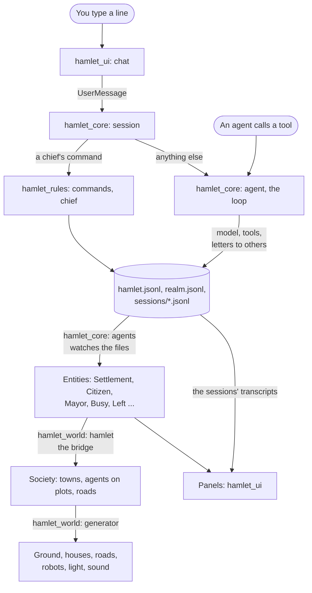

# A tour of the code

Where things are and where to change them. For what Hamlet is and how to
run it, read [`README.md`](../README.md) first. For the rules of working
here, [`AGENTS.md`](../AGENTS.md).

## The idea in one paragraph

Agents are folders and append-only records on disk. The core runs their
loops and writes the records. Everything shown is rebuilt from the records:
first as entities, then as a small model of towns, houses and roads, then
as a drawn world with panels around it. Nothing on screen is the truth; the
files are.

## How a change travels



## The crates

All are under `crates/`, and each depends only on those above it in this
table. The binary and the examples are the root package.

| Crate | What it is |
|---|---|
| `hamlet_sandbox` | Per-platform process sandboxes |
| `hamlet_model` | The model client, its settings, the catalogue of models, the session log |
| `hamlet_home` | A home on disk: its layout, charter and prompt, the chief's limits, the starter skills |
| `hamlet_rules` | The hamlet's record and the rules over it. Plain files and functions, no Bevy |
| `hamlet_core` | The runtime as Bevy plugins: agents, sessions, tools and oversight. No rendering |
| `hamlet_assets` | The files under `assets/`, built into the app and loaded as Bevy assets |
| `hamlet_vfx` | The visual effects: what each is and how it plays |
| `hamlet_world` | The 3D world, drawn from the core's entities |
| `hamlet_ui` | The window: panels, menus, chat and pointer around the world |

Inside a crate, a module with several subjects is a file and a folder of
the same name, and each file opens with a line saying what it holds. Read
`lib.rs` for the list.

`hamlet_world` has one folder for each thing in the world: `generator/`
(land, towns, houses, roads and traffic from a seed), `keeper/` (the
robots), `chief/` (the wizard and its Hearth), `hand/` (what the chief does
by hand), `pick/` (pointing, selecting and the camera) and `sound/`.
`hamlet_ui` has one file or folder for each panel, and `theme.rs`,
`looks.rs`, `feel/` and `icons.rs` for how they look.

Names to keep apart:

- `hamlet_core/src/agent.rs` is the loop one agent runs. `agents.rs` is
  every agent as an entity.
- `hamlet_rules/src/hamlet.rs` is a hamlet's record on disk.
  `hamlet_world/src/hamlet.rs` is the bridge that puts hamlets into the
  world.
- `chief.rs` is a chief's commands in `hamlet_rules`, the wizard in
  `hamlet_world` and the chief's panel in `hamlet_ui`.
- `hand.rs` is the hand in `hamlet_world`. In `hamlet_ui` it carries what
  the hand did to the core.

## Where do I change...

Paths are under `crates/`.

| To change | Go to |
|---|---|
| What an agent is told every turn | [`prompt.md`](prompt.md); the charter is `assets/charter.md` |
| The tools an agent has | `hamlet_core/src/tools/`; the hamlet's own in `hamlet_core/src/agent/hamlet_tools.rs` |
| A chief's slash command | The table `ALL` in `hamlet_rules/src/commands.rs`, which names who carries it out |
| What needs the chief's approval | `hamlet_core/src/oversight/danger.rs` |
| What an agent's commands may touch | `hamlet_sandbox/src/`; [`sandbox.md`](sandbox.md) |
| The folder a hamlet works on | `hamlet_rules/src/work.rs` keeps it; `Tools::work_on` in `hamlet_core/src/tools.rs` applies it |
| The workbench and its clockwork on a common | `hamlet_world/src/works.rs` |
| The library of shared skills | `hamlet_rules/src/library.rs` |
| Spending and limits | `hamlet_rules/src/budget/`, `hamlet_home/src/limits.rs` |
| Models, their prices and who may run them | `hamlet_model/src/catalogue.rs`, `hamlet_rules/src/models.rs` |
| The model client | `hamlet_model/src/provider/` |
| Removing, merging, restoring an agent | `hamlet_rules/src/lifecycle.rs` |
| Founding, naming, moving, closing a hamlet | `hamlet_rules/src/realm.rs` |
| A starter skill | `hamlet_home/starters/<name>/SKILL.md` |
| A panel | Its file in `hamlet_ui/src/` |
| The right-click menu | `hamlet_ui/src/world_menu/items.rs` |
| A colour in the panels | `hamlet_ui/src/theme.rs` |
| How a control looks or feels | `hamlet_ui/src/looks.rs`, `feel/`; [`ui-warmth.md`](ui-warmth.md) |
| An icon | `hamlet_ui/src/icons.rs`; [`icons.md`](icons.md) |
| A colour in the world | `assets/palette.toml` |
| A size, speed or timing | `assets/world.toml`, `vfx.toml`, `ui.toml`. What each value means is beside its field in the code |
| The height something stands at | `LandData::surface`: the ground as it is drawn, never the smooth `height` |
| How a house looks | `hamlet_world/src/generator/house.rs` |
| How a robot moves | `hamlet_world/src/keeper/acts/`; [`robots.md`](robots.md) |
| An effect | `hamlet_vfx/src/`; when it is set off, `hamlet_world/src/generator/magic.rs` |
| A sound or the music | `hamlet_world/src/sound/`; [`sound.md`](sound.md) |
| The camera | `hamlet_world/src/pick/camera.rs` |
| The wizard or the Hearth | `hamlet_world/src/chief/`; [`chief.md`](chief.md) |
| What is saved between launches | `hamlet_ui/src/remember.rs`; settings in `hamlet_model/src/config.rs` |

## Tuning while the app runs

The files under `assets/` are built into the app. With the `hot-reload`
feature they are also watched: save a change and the running app takes it.

```sh
HAMLET_HOME=/tmp/hamlet-try cargo run --features hot-reload
```

Three things do not follow a saved change: the `[generator]` section of
`world.toml`, since the land keeps the settings it was built from; the
colour of a mesh that is already built; and `charter.md`, which a home's
own `charter.md` overrides instead.

A file that cannot be read is reported and the last good values stay.

## Seeing your work without a window

These draw to files and open nothing:

| Command | Shows |
|---|---|
| `cargo run --example ui_gallery -- --scene <name> --out <dir>` | One panel scene. `examples/ui_gallery/main.rs` lists the scenes |
| `cargo run --release --example far_lands -- --out <dir>` | The land, many towns, a town being moved; `--bench` times it |
| `cargo run --example chief_sheet -- --out <dir>` | The wizard, its looks, a Wickstep, the library |
| `cargo run --example cursor_sheet` | Every cursor |
| `cargo run --release --example sound_sheet` | Every sound and the music, as WAV files |

`style_test` (one fixed scene and the robots' motions) and `town_gen` (the
generated world, grown from the keyboard) open a window.

Run the app itself against a scratch home, never your own:

```sh
HAMLET_HOME=/tmp/hamlet-try cargo run
```
