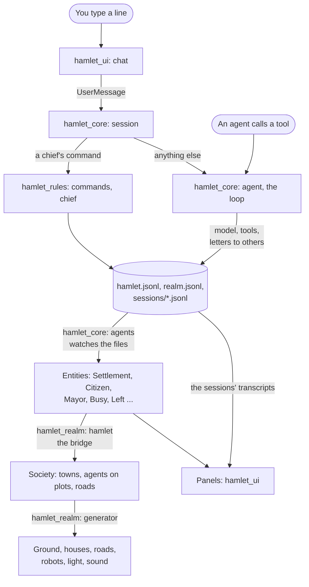

# A tour of the code

Where things are and where to change them. For what Hamlet is and how to
run it, read [`README.md`](../README.md) first. For the rules of working
here, [`AGENTS.md`](../AGENTS.md).

## The idea in one paragraph

Agents are folders and append-only records on disk. The core runs their
loops and writes the records. Everything shown is rebuilt from the records:
first as entities, then as a small model of towns, houses and roads, then
as a drawn world with panels around it. Nothing on screen is the truth; the
files are.

## How a change travels



## The crates

Each depends only on those above it in this table. The agent core, the
first five, is under `engine/`, since the engine runs it too; the rest are
under `crates/`. The binary and the examples are the root package.

| Crate | Folder | What it is |
|---|---|---|
| `hamlet_sandbox` | `engine/sandbox` | Per-platform process sandboxes |
| `hamlet_model` | `engine/model` | The model client, its settings, the catalogue of models, the session log |
| `hamlet_home` | `engine/home` | A home on disk: its layout, charter and prompt, the chief's limits, the starter skills |
| `hamlet_rules` | `engine/rules` | The hamlet's record and the rules over it. Plain files and functions, no Bevy |
| `hamlet_core` | `engine/agent_core` | The runtime as Bevy plugins: agents, sessions, tools and oversight. No rendering |
| `hamlet_desktop` | `crates/hamlet_desktop` | The machine the app runs on: kept awake while an agent works, its programs that show a file or a link, its folder dialog and the app's icon |
| `hamlet_assets` | `crates/hamlet_assets` | The files under `assets/`, built into the app and loaded as Bevy assets |
| `hamlet_vfx` | `crates/hamlet_vfx` | The visual effects: what each is and how it plays |
| `hamlet_realm` | `crates/hamlet_realm` | The 3D world, drawn from the core's entities |
| `hamlet_ui` | `crates/hamlet_ui` | The window: panels, menus, chat and pointer around the world |

Inside a crate, a module with several subjects is a file and a folder of
the same name, and each file opens with a line saying what it holds. Read
`lib.rs` for the list.

`hamlet_realm` has one folder for each thing in the world: `generator/`
(land, towns, houses, roads and traffic from a seed), `keeper/` (the
robots), `chief/` (the wizard and its Hearth), `hand/` (what the chief does
by hand), `pick/` (pointing, selecting and the camera) and `sound/`.
`RealmPlugin` in its `lib.rs` is the one thing the app adds: a flat list of
the `plugin` of each module, scene first (settings, palette, play, sound,
debug, sky, stage, keeper, stock), then the generator, then what the chief does in it, then
`hamlet.rs`. An app that wants only the scene adds the first group itself,
as the style test does; the town generator adds it with `generator::plugin`
and an `Origin` for its seed.
`hamlet_ui` has `screens/` for the panels that draw from the core's state
alone, one file or folder each, and `widgets/` for what every panel is built
from: `feel/`, `icons.rs`, `tabs.rs`, `platform.rs` and `tuning.rs`. The
other panels are files beside them, and `theme.rs` and `looks.rs` are how
things look.

Names to keep apart:

- `hamlet_core/src/agent.rs` is the loop one agent runs. `agents.rs` is
  every agent as an entity.
- `hamlet_rules/src/hamlet.rs` is a hamlet's record on disk.
  `hamlet_realm/src/hamlet.rs` is the bridge that puts hamlets into the
  world.
- `chief.rs` is a chief's commands in `hamlet_rules`, the wizard in
  `hamlet_realm` and the chief's panel in `hamlet_ui`.
- `hand.rs` is the hand in `hamlet_realm`. In `hamlet_ui` it carries what
  the hand did to the core.

## Where do I change...

Paths are under the crate's folder in the table above.

| To change | Go to |
|---|---|
| What an agent is told every turn | [`prompt.md`](prompt.md); the charter is `assets/charter.md` |
| The tools an agent has | `hamlet_core/src/tools/`; the hamlet's own in `hamlet_core/src/agent/hamlet_tools.rs` |
| The questions an agent asks the chief | `hamlet_rules/src/chief/asking.rs`; their card, in Needs You and the chat, in `hamlet_ui/src/asking.rs` |
| Selecting and copying text in the panels | `hamlet_ui/src/select.rs`; [`chat.md`](chat.md) |
| A chief's slash command | The table `ALL` in `hamlet_rules/src/commands.rs`, which names who carries it out |
| What needs the chief's approval | `hamlet_core/src/oversight/danger.rs` |
| What an agent's commands may touch | `hamlet_sandbox/src/`; [`sandbox.md`](sandbox.md) |
| The folder a hamlet works on | `hamlet_rules/src/work.rs` keeps it; `Tools::work_on` in `hamlet_core/src/tools.rs` applies it |
| The workbench and its clockwork on a common | `hamlet_realm/src/works.rs` |
| The library of shared skills | `hamlet_rules/src/library.rs` |
| Spending and limits | `hamlet_rules/src/budget/`, `hamlet_home/src/limits.rs` |
| Models, their prices and who may run them | `hamlet_model/src/catalogue.rs`, `hamlet_rules/src/models.rs` |
| The model client | `hamlet_model/src/provider/` |
| Signing in with ChatGPT to run models on the chief's plan | `hamlet_model/src/chatgpt.rs`; its client, on the Responses API, in `hamlet_model/src/provider/responses.rs` |
| Removing, merging, restoring an agent | `hamlet_rules/src/lifecycle.rs` |
| Founding, naming, moving, closing a hamlet | `hamlet_rules/src/realm.rs` |
| A starter skill | `hamlet_home/starters/<name>/SKILL.md` |
| A panel | Its file in `hamlet_ui/src/screens/`, or in `hamlet_ui/src/` |
| The right-click menu | `hamlet_ui/src/world_menu/items.rs` |
| A colour in the panels | `assets/theme.toml`, its fields in `hamlet_ui/src/theme.rs` |
| How a control looks or feels | `hamlet_ui/src/looks.rs`, `widgets/feel/`; [`ui-warmth.md`](ui-warmth.md) |
| An icon | `hamlet_ui/src/widgets/icons.rs`; [`icons.md`](icons.md) |
| A colour in the world | `assets/palette.toml` |
| A size, speed or timing | `assets/world.toml`, `vfx.toml`, `ui.toml`. What each value means is beside its field in the code |
| The height something stands at | `LandData::surface`: the ground as it is drawn, never the smooth `height` |
| How a house looks | `hamlet_realm/src/generator/house.rs` |
| How a robot moves | `hamlet_realm/src/keeper/acts/`; [`robots.md`](robots.md) |
| An effect | `hamlet_vfx/src/`; when it is set off, `hamlet_realm/src/generator/magic.rs` |
| A sound or the music | `hamlet_realm/src/sound/`; [`sound.md`](sound.md) |
| The camera | `hamlet_realm/src/pick/camera.rs` |
| The wizard or the Hearth | `hamlet_realm/src/chief/`; [`chief.md`](chief.md) |
| What is saved between launches | `hamlet_ui/src/remember.rs`; settings in `hamlet_model/src/config.rs` |
| The engine, apart from the app | `engine/`; [`engine.md`](engine.md) |
| A budget or limit of an engine plugin | `engine/tuning/engine.toml`; the caps every plugin is held to alike in `engine/core/src/budget.rs`, a plugin's own memory in `engine/api/src/limits.rs`, resolved with its manifest's and the person's in `engine/plugins/src/limits.rs` and shown on its page in the Plugins panel in `engine/plugins/src/list/limits.rs`; [`engine.md`](engine.md#limits) |
| The engine's Plugins panel: the list, its search and filter, and each plugin's page | `engine/plugins/src/list.rs`, the page in `list/page.rs`; a section another crate adds to every page is a `PluginPageSection`, as WHAT IT MAY DO in `engine/grants/src/page.rs`; [`engine.md`](engine.md#plugins) |
| The breadcrumb over a page within a panel | `breadcrumb` in `engine/shell/src/style.rs`; a plugin's in `plugins/agents_ui/src/breadcrumb.rs` |
| What engine plugins share | `engine/assets/` (assets), `engine/bus/` (services and events), `engine/net/` (fetches) |
| What plugins may ask of the agents | `engine/api/src/agents.rs`, answered in `engine/agents/src/answer.rs`; [`engine.md`](engine.md#the-agents) |
| What a plugin is told when the agents change | `engine/agents/src/watch.rs` |
| Keeping the machine awake, opening an address or a file for a plugin, the address under the pointer, a second launch | `engine/desktop/`; what plugins may ask in `engine/api/src/desktop.rs`; [`engine.md`](engine.md#the-desktop) |
| Run in Background and the window coming back | `engine/shell/src/window.rs`; the second launch in `engine/desktop/src/launch.rs` |
| What a plugin and the engine say to each other | `engine/wit/hamlet_engine.wit`, the types in `engine/api/` |
| Writing or testing an engine plugin | `engine/sdk/`, `engine/samples/`, `engine/harness/` and `plugin_check`; [`engine.md`](engine.md) |
| A plugin that comes with Hamlet | A crate in `plugins/`, built by `scripts/build_plugins.sh`; where the engine finds them in `engine/core/src/bundle.rs`; [`engine.md`](engine.md#bundled-plugins) |
| The engine's Settings pages for the agents, Welcome, or the agents' facts on the status line | `plugins/settings/`, `plugins/welcome/`, `plugins/status/` |
| The engine's chat, Inspector, Skills or Needs panels | `plugins/chat/`, `plugins/inspector/`, `plugins/skills/`, `plugins/needs/`, sharing `plugins/agents_ui/` |
| The window's focus: the open conversation and the thing selected | `engine/agents/src/focus.rs`; the chat's data in `conversation.rs`, `archive.rs`, `roster.rs` and `needs.rs` beside it |
| A widget an engine plugin can show | Its kind and properties in `engine/wit/hamlet_engine.wit`, its element in `engine/sdk/src/ui/elements.rs`, its widget in `engine/wasm/src/retained.rs`, built from `engine/shell/src/style.rs` |
| The engine's switch, which every yes or no is set with | `switch` in `engine/shell/src/style.rs`, its sizes under `[space]` in `engine/tuning/theme.toml`; the `toggle` node draws it |
| The fades at the edges of a scroll area | `ScrollFade` in `engine/shell/src/fade.rs`, its depth `scroll_fade` under `[space]` in `engine/tuning/theme.toml` |
| A plugin's 3D scene, its viewport or the window behind the dock, its WGSL, compute and passes | The interfaces `scene` and `gpu` in `engine/wit/hamlet_engine.wit`; the host's side in `engine/wasm/src/scene.rs` and `scene/`; drawing, picking and the checks in `engine/render/`; the SDK's `engine/sdk/src/scene.rs`; [`engine.md`](engine.md#scenes-and-gpu-work) |
| The engine's realm in its Realm panel: land, towns, roads, robots, the Hearth, its camera and pointer | `plugins/realm/`, as `hamlet_realm` draws it; [`engine.md`](engine.md#bundled-plugins) |
| The first workspace of a new home, "Main" | `Workspaces::default` in `engine/shell/src/workspace.rs` |
| What an engine plugin adds outside its panels: settings pages, status items, overlays | `engine/api/src/contribution.rs`; the shell's `settings.rs`, `status.rs` and `overlay.rs` in `engine/shell/src/`; what a plugin changes on them in `engine/wasm/src/surfaces.rs` |

## Tuning while the app runs

The files under `assets/` are built into the app. With the `hot-reload`
feature they are also watched: save a change and the running app takes it.

```sh
HAMLET_HOME=/tmp/hamlet-try cargo run --features hot-reload
```

Three things do not follow a saved change: the `[generator]` section of
`world.toml`, since the land keeps the settings it was built from; the
colour of a mesh that is already built; and `charter.md`, which a home's
own `charter.md` overrides instead.

A file that cannot be read is reported and the last good values stay.

## Seeing your work without a window

These draw to files and open nothing:

| Command | Shows |
|---|---|
| `cargo run --example ui_gallery -- --scene <name> --out <dir>` | One panel scene. `examples/ui_gallery/main.rs` lists the scenes |
| `cargo run --release --example far_lands -- --out <dir>` | The land, many towns, a town being moved; `--bench` times it |
| `cargo run --example chief_sheet -- --out <dir>` | The wizard, its looks, a Wickstep, the library |
| `cargo run --example cursor_sheet` | Every cursor |
| `cargo run --release --example sound_sheet` | Every sound and the music, as WAV files |

`style_test` (one fixed scene and the robots' motions) and `town_gen` (the
generated world, grown from the keyboard) open a window.

Run the app itself against a scratch home, never your own:

```sh
HAMLET_HOME=/tmp/hamlet-try cargo run
```
